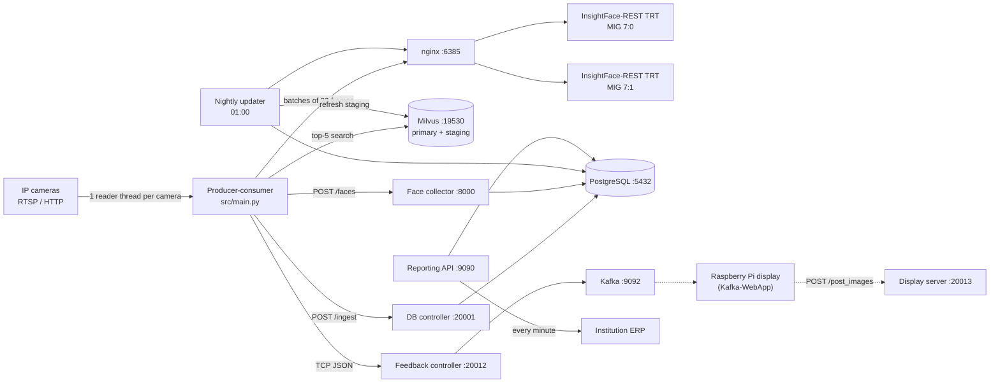

# CCTV Face Recognition Attendance System

Real-time, multi-camera face recognition that turns CCTV footage at campus gates, hostels and libraries into attendance records and posts them to each institution's ERP.

- **Detection and recognition:** [InsightFace-REST](https://github.com/SthPhoenix/InsightFace-REST) on a TensorRT backend: SCRFD (`scrfd_10g_gnkps`) for detection and ArcFace (`w600k_r50`) for 512-d embeddings, FP16, run as two replicas on separate NVIDIA MIG slices behind an nginx load balancer.
- **Identity search:** Milvus (GPU, `GPU_IVF_FLAT`, cosine) with a primary *enrolled* collection and a *staging* collection of faces captured from CCTV, used as a fallback to reduce the domain gap between enrollment photos and elevated-angle cameras.
- **Self-improving gallery:** a collector keeps each person's best face crops per camera cluster (pupil distance, match score), and a nightly job refreshes the staging vectors.
- **Outputs:** recognitions are stored in PostgreSQL (year/location partitioned), synced to the institution ERP every minute, exposed through a reporting API, and pushed over Kafka to on-site Raspberry Pi displays.

One deployment serves one institution, selected by `INSTITUTE` (currently `ABESIT` or `GLBITM`). The ABESIT main gate runs 20 CCTV cameras (10 entry, 10 exit).

## Architecture



Frames travel from the camera threads to the recognition threads through an in-memory `multiprocessing.Queue`. Kafka carries only recognition feedback and camera status messages, never frames.

### Recognition flow

1. Each camera thread reads a frame, crops the configured ROI polygon (or resizes to 640×360), skips it when the scene is too dark, and queues it.
2. A recognition thread takes 32 frames and sends them to InsightFace-REST `/extract`.
3. Every face embedding is searched against both Milvus collections (top 5).
4. A face is accepted when the top primary hit has cosine similarity ≥ 0.5. Failing that, when `STAGING = True`, the best primary hit that also appears in the staging top 5 is accepted at ≥ 0.45.
5. Accepted results go to the DB controller. Strict primary matches also go to the feedback controller (Kafka → displays) and to the face collector.

## Services

### Main stack (`docker-compose-main.yml`)

| Service | Entry point | Port (host:container) |
|---|---|---|
| Producer-consumer | `src/main.py` | — |
| PostgreSQL 12 | `postgres:12-bullseye` | 5432:5432 |
| Database controller | `src/database_server/postgresql_server_controller.py` | 20001:20001 |
| Feedback controller (Kafka publisher) | `src/feedback_server/feedback_msg_server_controller.py` | 20012:20012 |
| Reporting API + ERP sync | `src/api/app.py` | 9090:8000 |
| Dynamic face data collector | `src/dynamic_face_data_collector/api.py` | 8000:8000 |
| Nightly Milvus updater | `src/automatic-vector-db-updation/milvus_updater.py` | — |
| Display image server | `src/fetch_face_image_server/app.py` | 20013:20013 |

### Standalone stacks (`STANDALONE-SERVICES/`)

| Service | Image | Ports | GPU (MIG) |
|---|---|---|---|
| InsightFace-REST (×2) | `insightface-rest` (TensorRT) | 19000, 19001 → 18080 | 7:0, 7:1 (10 GB each) |
| nginx load balancer | `nginx` | 6385 → 18080 | — |
| Milvus standalone | `milvusdb/milvus:v2.5.1-gpu` (+ etcd, MinIO) | 19530, 9091, 9000, 9001 | 7:4 (5 GB) |
| Kafka broker (KRaft) | `confluentinc/cp-kafka:7.8.0` (+ Confluent tools) | 9092, 9101 | — |
| Face liveness detection (disabled) | `face-liveness-detection:v-beta` + nginx | 6970, 6971, 6386 | 7:2, 7:3 (5 GB each) |

Liveness detection (MiniFASNet anti-spoofing) is switched off by `ENABLE_FACE_LIVENESS_DETECTION = False` in `src/parameters.py`, and its start command is commented out.

## Configuration

### Secrets

Secrets are not stored in this repository. Copy the template and fill in the values; `docker-compose` reads `.env` from the project root automatically.

```bash
cp .env.example .env
```

| Variable | Used by |
|---|---|
| `POSTGRES_USER`, `POSTGRES_PASSWORD` | PostgreSQL and every service that connects to it |
| `API_KEY` | Reporting API (`?api_key=` query parameter) |
| `CAM_USERNAME`, `CAM_PASSWORD` | Default camera credentials |
| `ABESIT_HOST_IP`, `GLBITM_HOST_IP` | `set_configuration.sh`, to pick `INSTITUTE` from the host IP |

### Cameras

Real camera configurations are git-ignored. Create one per institute from the template:

```bash
cp src/Camera-Configuration/ABESIT/camera_configuration.example.json \
   src/Camera-Configuration/ABESIT/camera_configuration.json
```

Each location has an ERP `api-endpoint` and a set of `cctv-cameras` grouped by point (for example `entry` and `exit`). Each camera has `ip_address`, `port`, `endpoint`, `username`, `password` and an optional ROI polygon in `masking-coordinates`. A camera whose `username` or `password` is `null` falls back to `CAM_USERNAME` / `CAM_PASSWORD`. Kafka topics are named `<location>_<point>`, with one partition per camera.

To draw an ROI polygon on a live stream, run `Custom-ROI-Provisioning/crop_rectangle.py` with `RTSP_URL` set, then copy the printed points into `masking-coordinates`.

### Parameters

Runtime parameters such as batch size, thresholds, ports, staging and liveness flags live in [`src/parameters.py`](src/parameters.py). Host IP and institute are written to `master.env` and `STANDALONE-SERVICES/standalone-services.env` by `set_configuration.sh` at startup. InsightFace-REST models, batch sizes and MIG devices are set in `STANDALONE-SERVICES/standalone-services.env`.

## Getting started

### Prerequisites

- Linux host with Docker, Docker Compose and the NVIDIA Container Toolkit
- NVIDIA GPU with MIG instances matching `standalone-services.env` (developed on an NVIDIA DGX)
- [DVC](https://dvc.org/doc/install) access to the face datasets

### 1. Clone

```bash
git clone --recurse-submodules git@github.com:hamza-aziz-ai/CCTV-Face-Recognition-Attendance-System.git
cd CCTV-Face-Recognition-Attendance-System
find . -type f -name "*.sh" -exec chmod +x {} \;
```

### 2. Configure

Create `.env` and the camera configuration as described in [Configuration](#configuration).

### 3. Get the datasets

The face datasets are versioned with DVC on a Google Drive remote and are not stored in git:

| DVC file | Contents |
|---|---|
| `FACIAL-RECOGNITION-DATASET.dvc` | Enrollment photos and embedding pickles |
| `DISPLAY-FACE-DATASET.dvc` | Portraits shown on the displays (`<id>/front_face.jpg`) |

```bash
# Authenticate the Google Drive remote once on a machine with a browser,
# then copy ~/.gdrive to the server if needed
dvc remote modify --local face-recognition-dataset-gdrive gdrive_user_credentials_file ~/.gdrive/user-credentials.json
dvc pull
```

To add new data, run `dvc add FACIAL-RECOGNITION-DATASET`, commit the updated `.dvc` file, then `dvc push --remote face-recognition-dataset-gdrive`.

### 4. Build and start

```bash
./build-docker-images.sh        # build the application images
./start_complete_project.sh     # standalone stacks, then the main compose stack
```

To start in two steps instead, run `./start_standalone_services.sh`, then `docker-compose -f docker-compose-main.yml up -d`.

### 5. Enroll faces

Embeddings are created from the enrollment dataset and uploaded to the primary Milvus collection with interactive scripts:

```bash
python3 src/util/insightface_embeddings.py   # build an embeddings pickle for a group or batch
python3 src/util/upload_embeddings.py        # upload a pickle to the primary collection
```

When `upload_embeddings.py` asks whether to delete the existing collection, **Y replaces the whole primary collection** with the selected pickle and N appends to it.

### Stop

```bash
./stop_complete_project.sh
```

This also stops the standalone stacks: InsightFace-REST, Milvus and Kafka.

## Reporting API

All routes need `api_key` as a query parameter. Dates use `DD-MM-YYYY`.

| Method | Route | Returns |
|---|---|---|
| GET | `/fetch_person_data?date&person_id[&camera_name]` | Recognitions for a person on a date |
| GET | `/fetch_camera_data?date&camera_name` | Recognitions from one camera |
| GET | `/fetch_module_data?date&module` | Recognitions for one location |
| GET | `/fetch_tiled_frames?date&person_id` | PNG of the person's annotated frames |
| GET | `/fetch_frames_by_time?date&module[&start_time&end_time]` | PNG of frames in a time window (`HH:MM AM/PM`) |
| POST | `/manual_post?date&location` | Re-sends a day's records for a location to the ERP |

A background job posts the current day's unacknowledged recognitions to the ERP every minute and marks each one acknowledged on success.

## Data

| Store | Contents |
|---|---|
| PostgreSQL `<INSTITUTE>_CCTV_Camera_Surveillance` | `recognition_results`, partitioned by year and location, with the annotated frame |
| PostgreSQL `<INSTITUTE>_Face_Recognition_Database` | `person_summary` and `face_images` from the face collector |
| Milvus `<INSTITUTE>_FACE_DATA_COLLECTION_FOR_COSINE` | Enrolled embeddings (512-d) |
| Milvus `<INSTITUTE>_FACE_DATA_STAGING_COLLECTION_FOR_COSINE` | CCTV-captured embeddings |
| `DYNAMIC-FACIAL-RECOGNITION-DATASET/` | Collected face crops and `meta.json` per person and cluster |
| `logs/<year>/<month>/<logger>/` | Per-service logs, rotated at midnight, 31 kept |

The system stores biometric data (face images and embeddings) in several places. Apply your institution's access, retention and deletion policy to all of them.

## Project structure

```text
├── src/
│   ├── main.py                          # producer-consumer entry point
│   ├── parameters.py                    # runtime configuration
│   ├── multicam_stream_producer.py      # camera reader threads
│   ├── multicam_stream_consumer.py      # batching and recognition threads
│   ├── insightface_face_detection.py    # InsightFace-REST client
│   ├── insightface_face_recognition.py  # search, decision and dispatch
│   ├── inference_data_cleaner.py        # match rules
│   ├── milvus_server.py                 # Milvus helpers
│   ├── api/                             # reporting API and ERP sync
│   ├── database_server/                 # recognition ingest service
│   ├── feedback_server/                 # TCP to Kafka publisher
│   ├── dynamic_face_data_collector/     # face crop collector
│   ├── automatic-vector-db-updation/    # nightly staging updater
│   ├── fetch_face_image_server/         # portraits for the displays
│   ├── Camera-Configuration/            # per-institute camera config templates
│   └── util/                            # enrollment, dataset and development scripts
├── STANDALONE-SERVICES/                 # InsightFace-REST, Milvus, Kafka, face liveness
├── Custom-ROI-Provisioning/             # ROI drawing tool (crop_rectangle.py)
├── docker-compose-main.yml
├── *.Dockerfile
└── start_* / stop_* / set_configuration.sh
```

`Custom-ROI-Provisioning/app.py` is a legacy Flask tool that no longer runs against the current code.

## Raspberry Pi display

The display client lives in the `Kafka-WebApp` submodule. See [Kafka-WebApp/README.md](Kafka-WebApp/README.md) for first-time setup and [Kafka-WebApp/Configure-Parameters-for-Raspberry.md](Kafka-WebApp/Configure-Parameters-for-Raspberry.md) for changing parameters.

## Known issues

- The duplicate check in `src/database_server/postgresql_database.py` queries a `recognition_timestamp` column that the table does not define, and puts a `%s` placeholder inside a quoted interval. Recognition inserts fail unless the live table was migrated by hand.
- The application health checks end with `echo $?`, so they always report healthy; the API check also probes the wrong port.
- The nightly updater replaces all of a person's staging vectors with only that night's new crops.
- Face clusters are defined only for the ABESIT main-gate cameras, so the face collector rejects crops from other cameras.
- The images use Python 3.8 and PostgreSQL 12, both past end of life.

## Authors

Developed at Global InfoVentures Pvt. Ltd. by **Anubhav Patrick**, **Hamza Aziz** and **Kshitij Parashar**.

Third-party components:

- [InsightFace-REST](https://github.com/SthPhoenix/InsightFace-REST) (`STANDALONE-SERVICES/InsightFace-REST`)
- [Silent-Face-Anti-Spoofing](https://github.com/minivision-ai/Silent-Face-Anti-Spoofing) (`STANDALONE-SERVICES/Face-Liveness-Detection/src`)
