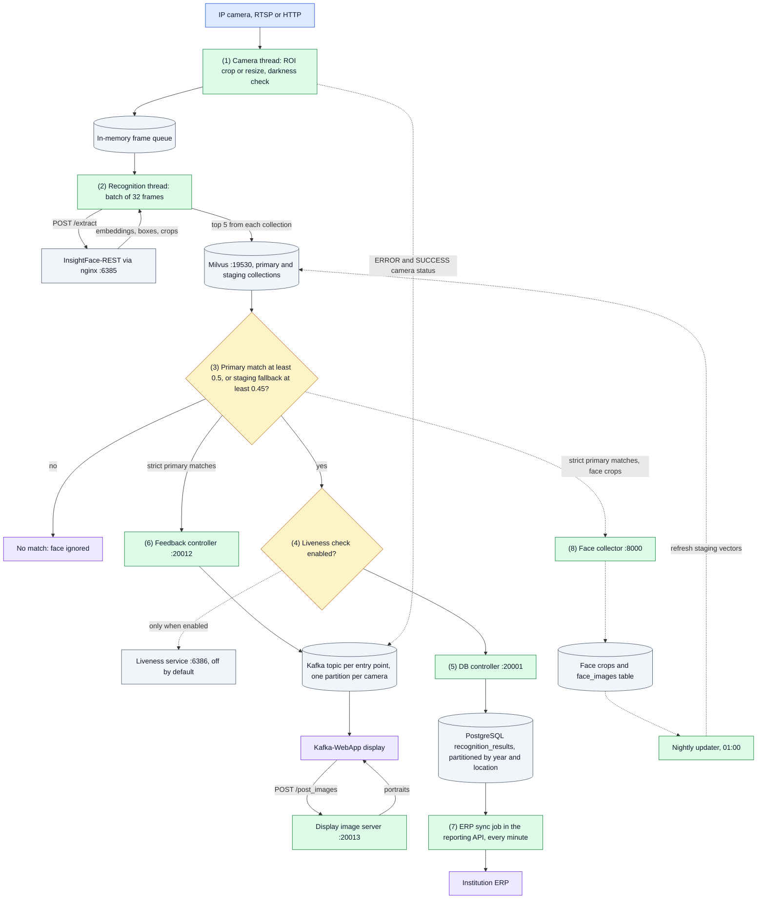
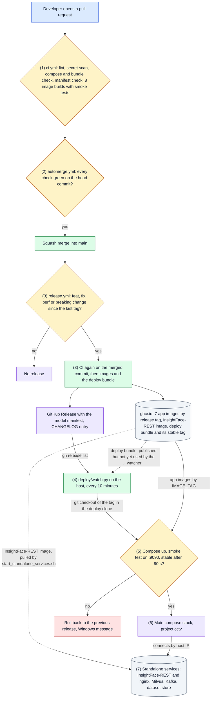

# CCTV Face Recognition Attendance System

Real-time, multi-camera face recognition that turns CCTV footage at campus gates, hostels and libraries into attendance records and posts them to each institution's ERP.

- **Detection and recognition:** [InsightFace-REST](https://github.com/SthPhoenix/InsightFace-REST) on a TensorRT backend: SCRFD (`scrfd_10g_gnkps`) for detection and ArcFace (`w600k_r50`) for 512-d embeddings, FP16. By default one container runs on GPU 0 behind an nginx proxy on port 6385 (D-032).
- **Identity search:** Milvus (GPU, `GPU_IVF_FLAT`, cosine) with a primary *enrolled* collection and a *staging* collection of faces captured from CCTV, used as a fallback to reduce the domain gap between enrollment photos and elevated-angle cameras.
- **Self-improving gallery:** a collector keeps each person's best face crops per camera cluster (pupil distance, match score), and a nightly job refreshes the staging vectors.
- **Outputs:** recognitions are stored in PostgreSQL (year and location partitions), synced to the institution's ERP every minute, exposed through a reporting API, and pushed over Kafka to on-site displays.

One deployment serves one site.

## System Design

How to read it: solid arrows are the path every recognition takes; dotted arrows are optional, cached or written on the side. Colors follow [docs/FLOW.md](docs/FLOW.md#how-to-read-the-diagrams): blue the way in, green a code step, amber a decision, purple an outcome, grey a data store or outside service.



1. **Camera input.** The producer process starts one thread per configured camera. Each thread reads frames, crops the camera's ROI polygon or resizes the frame to 640x360, and queues it with the camera name. When 80 of the last 100 frames are dark, the thread stops queueing and sends an `ERROR` message straight to the camera's Kafka partition, so the display can tell people why nothing is recognized.
2. **Detection and embeddings.** Four recognition threads take 32 frames at a time from the in-memory queue and send them to InsightFace-REST through nginx. The queue keeps frames off the network and out of Kafka; it is lost on restart.
3. **Identity search.** Every face is searched against both Milvus collections. A face is accepted when its best primary hit scores at least 0.5 (cosine). Otherwise, with `STAGING = True`, the best primary hit that also appears in the staging top 5 is accepted at 0.45 or more. Staging vectors come from CCTV crops, so they help people whose enrollment photos differ from how the cameras see them.
4. **Liveness.** Anti-spoofing exists but is off (`ENABLE_FACE_LIVENESS_DETECTION = False`). When on, a person whose crops look spoofed more often than real is dropped from the attendance records; the display and the collector still receive that person.
5. **Attendance record.** Accepted faces, with the annotated frame, go to the DB controller, which answers at once and writes to PostgreSQL in the background. Each record lands in a partition for its year and location.
6. **Display.** Strict primary matches go over TCP to the feedback controller, which publishes each person ID to the entry point's Kafka topic, on the camera's partition. Kafka-WebApp reads the topic, asks the display image server for portraits, and shows them. Staging matches are recorded but not displayed.
7. **ERP.** Every minute the reporting API posts the day's unacknowledged records to the location's ERP endpoint, and marks each one acknowledged when the ERP confirms it. The same service answers report queries.
8. **Gallery refresh.** Strict primary matches also send their face crops to the collector, which keeps the best three per person and camera cluster. At 01:00 the nightly updater embeds new crops and replaces that person's vectors in the staging collection.

Each step is traced in detail in [docs/FLOW.md](docs/FLOW.md).

## Solution Architecture

How to read it: solid arrows are what happens on every release; dotted arrows are optional or not used yet.



1. **Continuous integration.** Every pull request runs `ci.yml`. The aggregate `ci` check passes only when lint, the gitleaks scan, the compose and bundle checks, the model-manifest drift check and all eight image builds with their smoke tests pass. Beyond the watcher, enrollment-check, face-vector and bundle self-checks there are no unit tests (D-006).
2. **Auto-merge.** `automerge.yml` runs from main's copy after `ci` or the code-review workflow finishes. It squash-merges a non-draft pull request from this repository, and deletes its branch, only when every check on the latest commit passed (D-013, D-025). Green CI is the merge and ship gate; there is no human review step.
3. **Build and release.** After a merge, `release.yml` reads the merged pull request titles as Conventional Commits: `type!:` or a `BREAKING CHANGE` footer gives a major bump, `feat:` a minor one, `fix:` or `perf:` a patch, and anything else no release. It re-runs CI on the exact commit, pushes the seven app images to `ghcr.io/hamza-aziz-ai/cctv-face-recognition-<service>:<tag>`, builds the InsightFace-REST image if its source changed, and publishes the deploy bundle (D-033). Only then does it tag, create the GitHub Release with `mlops/model-manifest.json`, move the bundle's `stable` tag and add the notes to `CHANGELOG.md`. A failed release opens an issue for the owner (D-014, D-017, D-029). **Pull request titles must follow this convention.**
4. **Watcher.** `deploy/watch.py` runs from a dedicated deploy clone through Windows Task Scheduler. It deploys the newest published release only if the tag is on main, is not the current release and has not failed before. It also starts automerge for green pull requests left open (D-016, D-029).
5. **Deploy check.** The watcher checks out the tag, runs `docker compose up --pull missing --no-build --wait` with `IMAGE_TAG` set to it, waits for `http://localhost:9090/docs` to answer, then checks that no service is restarting or exited 90 seconds later. On failure it starts the previous release, records the failed tag so it is never retried unattended, and shows a Windows message. See [docs/ROLLBACK.md](docs/ROLLBACK.md).
6. **Live stack.** The main compose stack runs seven application containers, PostgreSQL and Kafka-WebApp. The watcher never starts a stack the owner stopped, and keeps only the current and previous release images.
7. **Standalone services.** InsightFace-REST, Milvus, Kafka and the dataset store run as separate compose stacks or containers, started by `start_standalone_services.sh`. The watcher does not manage them; they change only when someone runs that script. The deploy bundle that is meant to replace the deploy clone is published with each release but not used yet; switching the watcher to it is the next step of D-033.

Who owns which part, and the runtime ports, are in [docs/ARCHITECTURE.md](docs/ARCHITECTURE.md).

## Quick start

### Prerequisites

- A Linux host, or Windows with Docker Desktop, with Docker Compose and the NVIDIA Container Toolkit.
- An NVIDIA GPU. The defaults in `STANDALONE-SERVICES/standalone-services.env` put every GPU service on GPU 0 with small batches (tested on a 6 GB laptop GPU). A larger or multi-GPU host sets its own GPUs and batch sizes in a profile file under `STANDALONE-SERVICES/hosts/`, chosen by `HOST_PROFILE` in `.env` (D-015, D-032). No profile is committed today.
- [DVC](https://dvc.org/doc/install) access to the face datasets.

### 1. Clone

```bash
git clone --recurse-submodules git@github.com:hamza-aziz-ai/CCTV-Face-Recognition-Attendance-System.git
cd CCTV-Face-Recognition-Attendance-System
find . -type f -name "*.sh" -exec chmod +x {} \;
```

### 2. Configure

Secrets are not stored in this repository. Copy the template and fill in the values; Docker Compose reads `.env` from the project root.

```bash
cp .env.example .env
```

| Variable                                                            | Used by                                                                                             |
|---------------------------------------------------------------------|-----------------------------------------------------------------------------------------------------|
| `POSTGRES_USER`, `POSTGRES_PASSWORD`                                | PostgreSQL and every service that connects to it                                                    |
| `POSTGRES_HOST_PORT`                                                | Host port for PostgreSQL when 5432 is taken; default 5432                                           |
| `API_KEY`                                                           | Reporting API (`?api_key=` query parameter)                                                         |
| `CAM_USERNAME`, `CAM_PASSWORD`                                      | Default camera credentials                                                                          |
| `HOST_PROFILE`                                                      | Optional GPU profile under `STANDALONE-SERVICES/hosts/`                                             |
| `DATASET_STORE_USER`, `DATASET_STORE_PASSWORD`, `DATASET_STORE_DIR` | Dataset store (MinIO DVC remote): root login and the host folder holding the data, outside the repo |

The camera configuration is git-ignored. Create it from the template:

```bash
cp src/Camera-Configuration/camera_configuration.example.json src/Camera-Configuration/camera_configuration.json
```

Each location has an ERP `api-endpoint` and a set of `cctv-cameras` grouped by entry point (for example `entry` and `exit`). Each camera has `ip_address`, `port`, `endpoint`, `username`, `password` and an optional ROI polygon in `masking-coordinates`. A camera whose `username` or `password` is `null` falls back to `CAM_USERNAME` and `CAM_PASSWORD`. Camera keys end in a number (`cctv-camera-1`), which sets the camera's Kafka partition. To draw an ROI polygon on a live stream, run `Custom-ROI-Provisioning/crop_rectangle.py` with `RTSP_URL` set, then copy the printed points into `masking-coordinates`.

Runtime parameters such as batch size, thresholds, ports and the staging and liveness flags live in [`src/parameters.py`](src/parameters.py). At startup `set_configuration.sh` writes the host IP to `master.env` (created from `master.env.example`, not tracked) and to `STANDALONE-SERVICES/standalone-services.env`. InsightFace-REST models, batch sizes and GPU devices are set in `standalone-services.env`.

### 3. Get the datasets

The face datasets are versioned with DVC, not git. The default remote `minio` is the dataset store started by `start_standalone_services.sh` (bucket `dvc`, S3 API on port 9010, D-019). The datasets were restarted from scratch in October 2026 (D-026).

| DVC file                         | Contents                                                |
|----------------------------------|---------------------------------------------------------|
| `FACIAL-RECOGNITION-DATASET.dvc` | Enrollment photos and each person's `vectors.parquet`   |
| `DISPLAY-FACE-DATASET.dvc`       | Portraits shown on the displays (`<id>/front_face.jpg`) |

```bash
# Credentials stay in .dvc/config.local (git-ignored); use the DATASET_STORE_* values from .env
dvc remote modify --local minio access_key_id <DATASET_STORE_USER>
dvc remote modify --local minio secret_access_key <DATASET_STORE_PASSWORD>
# On any machine other than the dataset store host, point at that host
dvc remote modify --local minio endpointurl http://<store-host>:9010
dvc pull
```

To add data, run `dvc add FACIAL-RECOGNITION-DATASET`, commit the updated `.dvc` file, then `dvc push`.

### 4. Build and start

```bash
docker compose -f docker-compose-main.yml -f docker-compose.dev.yml build   # build the application images
./start_complete_project.sh     # standalone stacks, then the main compose stack
```

To start in two steps instead, run `./start_standalone_services.sh`, then `docker-compose -f docker-compose-main.yml up -d`.

The images contain the application source, so rebuild them after code changes. For development, start with both files (`docker compose -f docker-compose-main.yml -f docker-compose.dev.yml up -d`): `docker-compose.dev.yml` mounts `./src` over the baked copy in every service except the producer-consumer, so edits to those services apply on restart without a rebuild. The producer-consumer always runs the code in its image.

### 5. Enroll faces

Put each person's photos in `FACIAL-RECOGNITION-DATASET/<person_id>/`: `front.jpg`, `chin_up.jpg`, `chin_down.jpg`, `left_30.jpg` and `right_30.jpg`, plus the same five with `_glasses` for someone who wears glasses. Get each person's written consent first: these are biometric data.

```bash
python3 src/util/enrol_person.py FACIAL-RECOGNITION-DATASET/<person_id>
```

Nothing is enrolled unless every photo passes the checks. The script saves the vectors next to the photos and publishes a new version of the primary collection (D-026, D-030). Then version the dataset: `dvc add FACIAL-RECOGNITION-DATASET`, commit the `.dvc` file, `dvc push`. Run `python3 src/util/face_vectors.py migrate` once before the first enrollment on an existing install. The checks, version switching and the scripts for whole groups are described in [docs/FLOW.md](docs/FLOW.md#7-enrollment-and-face-vector-publishing).

### Stop

```bash
./stop_complete_project.sh
```

This also stops the standalone stacks: InsightFace-REST, Milvus, Kafka and the dataset store.

## Documentation

| Document                                    | What it covers                                                                                                        |
|---------------------------------------------|-----------------------------------------------------------------------------------------------------------------------|
| [ARCHITECTURE.md](docs/ARCHITECTURE.md)     | Modules and what they own; runtime topology with ports; how a change reaches production; where data lives; deployment |
| [FLOW.md](docs/FLOW.md)                     | Each flow step by step: startup, recognition, records, display, ERP and reports, gallery, enrollment, release         |
| [DATA.md](docs/DATA.md)                     | Every data store: shape, size, writers, readers and trade-offs                                                        |
| [DECISIONS.md](docs/DECISIONS.md)           | Decision records, D-001 onward                                                                                        |
| [ALTERNATIVES.md](docs/ALTERNATIVES.md)     | Options considered and not taken                                                                                      |
| [THREAT.md](docs/THREAT.md)                 | Threat model: entry points, abuse, gaps and what to close first                                                       |
| [FAILURE.md](docs/FAILURE.md)               | How each component fails and what happens then                                                                        |
| [ROLLBACK.md](docs/ROLLBACK.md)             | How to undo a release, a data change or a standalone service change                                                   |
| [TEST-CHECKLIST.md](docs/TEST-CHECKLIST.md) | Live checks after a deploy or rollback                                                                                |
| [CONSTRAINTS.md](docs/CONSTRAINTS.md)       | Fixed limits the design works within                                                                                  |
| [ALLOW-POLICY.md](docs/ALLOW-POLICY.md)     | What automation may do without asking                                                                                 |
| [ASSUMPTIONS.md](docs/ASSUMPTIONS.md)       | Assumptions not yet proven                                                                                            |
| [DEPENDENCIES.md](docs/DEPENDENCIES.md)     | External dependencies and secrets                                                                                     |
| [DEFENSE.md](docs/DEFENSE.md)               | Defense brief                                                                                                         |
| [HANDOVER.md](docs/HANDOVER.md)             | Session handover notes, newest first                                                                                  |
| [Kafka-WebApp](Kafka-WebApp/README.md)      | Display client setup, kept in its own repository                                                                      |

## Known issues and limitations

- The duplicate check in `src/database_server/postgresql_database.py` queries a `recognition_timestamp` column that the table does not define, and puts a `%s` placeholder inside a quoted interval. Recognition inserts fail unless the live table was migrated by hand.
- The display reads only partition 0 of its topic (`CONFLUENT_KAFKA_PARTITION = 0` in Kafka-WebApp), so each display shows only camera 1 of its entry point. Messages from the other cameras are published but not shown.
- On this host, `kafka-webapp` starts reading only when ports 6385, 19000, 19001, 19530, 9092, 20001, 20012 and 20013 all answer (`PROJECT_SERVICES_PORT` in `docker-compose-main.yml`). With the default single InsightFace-REST container nothing listens on 19001, so it keeps waiting. Found by reading the code, not observed.
- nginx forwards to one InsightFace-REST container only; more containers from `INSIGHTFACE_GPUS` start but are not balanced (D-032).
- Face liveness detection is off, so a printed photo can be recognized.
- The nightly updater replaces all of a person's staging vectors with only that night's new crops, and still marks crops processed when the Milvus insert fails.
- Face clusters are defined only for the `maingate` entry and exit cameras, so the face collector rejects crops from other cameras.
- When a person's cluster already holds three crops and a new crop is not better than the worst, the `while` loop in `save_face_if_better()` (`src/dynamic_face_data_collector/face_saver.py`) never ends, and the synchronous call blocks the collector. Found by reading the code, not observed.
- Most internal services have no authentication: see [docs/THREAT.md](docs/THREAT.md).
- Separating client data and deployments is planned work (D-036), not part of main yet.

## Authors

Developed by **Hamza Aziz**.

Third-party components:

- [InsightFace-REST](https://github.com/SthPhoenix/InsightFace-REST) (`STANDALONE-SERVICES/InsightFace-REST`)
- [Silent-Face-Anti-Spoofing](https://github.com/minivision-ai/Silent-Face-Anti-Spoofing) (`STANDALONE-SERVICES/Face-Liveness-Detection/src`)
