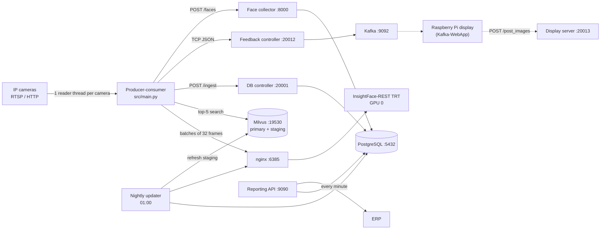

# CCTV Face Recognition Attendance System

Real-time, multi-camera face recognition that turns CCTV footage at campus gates, hostels and libraries into attendance records and posts them to each institution's ERP.

- **Detection and recognition:** [InsightFace-REST](https://github.com/SthPhoenix/InsightFace-REST) on a TensorRT backend: SCRFD (`scrfd_10g_gnkps`) for detection and ArcFace (`w600k_r50`) for 512-d embeddings, FP16, run as two replicas on separate NVIDIA MIG slices behind an nginx load balancer.
- **Identity search:** Milvus (GPU, `GPU_IVF_FLAT`, cosine) with a primary *enrolled* collection and a *staging* collection of faces captured from CCTV, used as a fallback to reduce the domain gap between enrollment photos and elevated-angle cameras.
- **Self-improving gallery:** a collector keeps each person's best face crops per camera cluster (pupil distance, match score), and a nightly job refreshes the staging vectors.
- **Outputs:** recognitions are stored in PostgreSQL (year/location partitioned), synced to the institution ERP every minute, exposed through a reporting API, and pushed over Kafka to on-site Raspberry Pi displays.

One deployment serves one site.

## Architecture



Frames travel from the camera threads to the recognition threads through an in-memory `multiprocessing.Queue`. Kafka carries only recognition feedback and camera status messages, never frames.

### Recognition flow

1. Each camera thread reads a frame, crops the configured ROI polygon (or resizes to 640×360), skips it when the scene is too dark, and queues it.
2. A recognition thread takes 32 frames and sends them to InsightFace-REST `/extract`.
3. Every face embedding is searched against both Milvus collections (top 5).
4. A face is accepted when the top primary hit has cosine similarity ≥ 0.5. Failing that, when `STAGING = True`, the best primary hit that also appears in the staging top 5 is accepted at ≥ 0.45.
5. Accepted results go to the DB controller. Strict primary matches also go to the feedback controller (Kafka → displays) and to the face collector.

## Services

### Main stack (`docker-compose-main.yml`)

| Service | Entry point | Port (host:container) |
|---|---|---|
| Producer-consumer | `src/main.py` | — |
| Database controller | `src/database_server/postgresql_server_controller.py` | not published (20001 inside the stack) |
| Feedback controller (Kafka publisher) | `src/feedback_server/feedback_msg_server_controller.py` | not published (20012 inside the stack) |
| Reporting API + ERP sync | `src/api/app.py` | `API_PORT` (9090):8000 |
| Dynamic face data collector | `src/dynamic_face_data_collector/api.py` | not published (8000 inside the stack) |
| Nightly Milvus updater | `src/automatic-vector-db-updation/milvus_updater.py` | — |
| Display image server | `src/fetch_face_image_server/app.py` | `DISPLAY_IMAGE_PORT` (20013):20013 |

`kafka-webapp` (`ghcr.io/hamza-aziz-ai/kafka-webapp`, port `DISPLAY_PORT`, 9095) is the recognition display for this host. It is versioned in the `Kafka-WebApp` submodule's repository.

Each client on a host runs this stack as its own compose project, `cctv` for the owner and `cctv-<client>` for the others (D-036). Containers have no fixed names, each project has its own network, and services reach the DB controller, feedback controller and face collector by service name, so those ports are not published. Logs and recognition frames go to `logs/` and `Recognition_Frames/` in the client's site folder. Published ports default to the values above; a second client on the same host sets its own in its site `.env`.

Upgrading a host from a release that ran PostgreSQL inside this stack: the old container keeps running as an orphan of project `cctv`, and the stack keeps using it. To move it to the shared service, run `docker rm -f cctv-face-recognition-postgresql-database`, then `./start_standalone_services.sh`. The data folder is the same. Older logs stay in `/workspace/FACE_RECOGNITION_ATTENDANCE_SYSTEM_LOGS/` inside the Docker Desktop VM.

### Standalone stacks (`STANDALONE-SERVICES/`)

| Service | Image | Ports | GPU (default) |
|---|---|---|---|
| InsightFace-REST | `insightface-rest` (TensorRT) | 19000 → 18080 | 0 |
| nginx load balancer | `nginx` | 6385 → 18080 | — |
| Milvus standalone | `milvusdb/milvus:v3.0.5-gpu` (+ etcd 3.5.25, Milvus-tested MinIO) | 19530, 9091, 9000, 9001 | 0 |
| Kafka broker (KRaft) | `confluentinc/cp-kafka:8.4.0` (+ Schema Registry, Connect, ksqlDB, REST Proxy, Flink: cp-all-in-one community 8.4.0) | 9092, 9101 | — |
| Dataset store (DVC remote) | `pgsty/minio` (MinIO) | 9010 (S3 API), 9011 (console) | — |
| PostgreSQL 18, shared by every client stack | `postgres:18.6-trixie` | `POSTGRES_HOST_PORT` (5432) | — |
| Face liveness detection (disabled) | `face-liveness-detection:v-beta` + nginx | 6970, 6971, 6386 | 0, 0 |

Liveness detection (MiniFASNet anti-spoofing) is switched off by `ENABLE_FACE_LIVENESS_DETECTION = False` in `src/parameters.py`, and its start command is commented out.

## Configuration

### Secrets

Secrets are not stored in this repository. Copy the template and fill in the values; `docker-compose` reads `.env` from the project root automatically.

```bash
cp .env.example .env
```

| Variable | Used by |
|---|---|
| `POSTGRES_USER`, `POSTGRES_PASSWORD` | PostgreSQL and every service that connects to it |
| `API_KEY` | Reporting API (`?api_key=` query parameter) |
| `CAM_USERNAME`, `CAM_PASSWORD` | Default camera credentials |
| `API_PORT`, `DISPLAY_IMAGE_PORT`, `DISPLAY_PORT` | Published ports of this client's stack (9090, 20013, 9095 if unset); only a second client on the same host needs them |
| `DATASET_STORE_USER`, `DATASET_STORE_PASSWORD`, `DATASET_STORE_DIR` | Dataset store (MinIO DVC remote): root login and the host folder holding the data, outside the repo |

### Cameras

The real camera configuration is git-ignored. Create it from the template:

```bash
cp src/Camera-Configuration/camera_configuration.example.json \
   src/Camera-Configuration/camera_configuration.json
```

Each location has an ERP `api-endpoint` and a set of `cctv-cameras` grouped by point (for example `entry` and `exit`). Each camera has `ip_address`, `port`, `endpoint`, `username`, `password` and an optional ROI polygon in `masking-coordinates`. A camera whose `username` or `password` is `null` falls back to `CAM_USERNAME` / `CAM_PASSWORD`. Kafka topics are named `<location>_<point>`, with one partition per camera.

To draw an ROI polygon on a live stream, run `Custom-ROI-Provisioning/crop_rectangle.py` with `RTSP_URL` set, then copy the printed points into `masking-coordinates`.

### Parameters

Runtime parameters such as batch size, thresholds, ports, staging and liveness flags live in [`src/parameters.py`](src/parameters.py). The host IP is written to `master.env` (created from `master.env.example` on first run, not tracked) and `STANDALONE-SERVICES/standalone-services.env` by `set_configuration.sh` at startup. `master.env` also names the client the site serves, `CLIENT_ID` (D-036): every service refuses to start without a valid one, and `CLIENT_ID=owner` keeps the database, collection and topic names used before. InsightFace-REST models, batch sizes and GPU devices are set in `STANDALONE-SERVICES/standalone-services.env`.

## Getting started

### Prerequisites

- Linux host with Docker, Docker Compose and the NVIDIA Container Toolkit
- An NVIDIA GPU. The defaults in `standalone-services.env` put every service on GPU 0 with small batches (tested on a 6 GB laptop GPU); a larger or multi-GPU host sets its own GPUs and batch sizes in a profile under `STANDALONE-SERVICES/hosts/`, chosen by `HOST_PROFILE` in `.env`
- [DVC](https://dvc.org/doc/install) access to the face datasets

### 1. Clone

```bash
git clone --recurse-submodules git@github.com:hamza-aziz-ai/CCTV-Face-Recognition-Attendance-System.git
cd CCTV-Face-Recognition-Attendance-System
find . -type f -name "*.sh" -exec chmod +x {} \;
```

### 2. Configure

Create `.env` and the camera configuration as described in [Configuration](#configuration).

### 3. Get the datasets

The face datasets are versioned with DVC and are not stored in git. The default remote `minio` is the dataset store started by `start_standalone_services.sh` (bucket `dvc`, S3 API on port 9010, D-019). The datasets were restarted from scratch in October 2026 (D-026):

| DVC file | Contents |
|---|---|
| `FACIAL-RECOGNITION-DATASET.dvc` | Enrollment photos and embedding pickles |
| `DISPLAY-FACE-DATASET.dvc` | Portraits shown on the displays (`<id>/front_face.jpg`) |

```bash
# Credentials stay in .dvc/config.local (git-ignored); use the DATASET_STORE_* values from .env
dvc remote modify --local minio access_key_id <DATASET_STORE_USER>
dvc remote modify --local minio secret_access_key <DATASET_STORE_PASSWORD>
# On any machine other than the dataset store host, point at that host
dvc remote modify --local minio endpointurl http://<store-host-ip>:9010
dvc pull
```

To add new data, run `dvc add FACIAL-RECOGNITION-DATASET`, commit the updated `.dvc` file, then `dvc push`.


### 4. Build and start

```bash
docker compose -f docker-compose-main.yml -f docker-compose.dev.yml build   # build the application images
./start_complete_project.sh     # standalone stacks, then the main compose stack
```

To start in two steps instead, run `./start_standalone_services.sh`, then `docker-compose -f docker-compose-main.yml up -d`.

The images contain the application source, so rebuild them after code changes. For development, start with both files (`docker compose -f docker-compose-main.yml -f docker-compose.dev.yml up -d`): `docker-compose.dev.yml` mounts `./src` over the baked copy, so edits apply on restart without a rebuild.

### 5. Enroll faces

Put each person's photos in `FACIAL-RECOGNITION-DATASET/<person_id>/`: `front.jpg`, `chin_up.jpg`, `chin_down.jpg`, `left_30.jpg` and `right_30.jpg`, plus the same five with `_glasses` for someone who wears spectacles. Get each person's written consent first: these are biometric data.

```bash
python3 src/util/enrol_person.py FACIAL-RECOGNITION-DATASET/<person_id>
```

It saves the vectors to `vectors.parquet` in the person's folder and publishes a new version of the primary collection (D-030). Then version the dataset: `dvc add FACIAL-RECOGNITION-DATASET`, commit the `.dvc` file, `dvc push`. `python3 src/util/face_vectors.py use <n>` switches back to an earlier version. Run `python3 src/util/face_vectors.py migrate` once before the first enrolment on an existing install.

Nothing is enrolled unless every photo passes: the full set is present, each has exactly one face with confidence of at least 0.7 and pupils at least 28 px apart, each matches the person's other photos, and none matches someone already enrolled.

Whole groups can still go through these scripts, without the photo checks:

```bash
python3 src/util/insightface_embeddings.py <folder> <embeddings.pkl>   # build an embeddings pickle for a group
python3 src/util/upload_embeddings.py <embeddings.pkl>                  # save a pickle to the dataset and publish
```

`upload_embeddings.py` replaces the vectors of the people in the pickle and keeps everyone else.

### Stop

```bash
./stop_complete_project.sh
```

This also stops the standalone stacks: InsightFace-REST, Milvus and Kafka.

## CI/CD

- **CI** (`.github/workflows/ci.yml`) runs on every PR: lint, secret scan, compose validation, model-manifest drift check, watcher tests, and builds and smoke-tests all 8 images. The aggregate check is `ci`.
- **Auto-merge** (`automerge.yml`): a PR into `main` is squash-merged, and its branch deleted, once `ci` and every other check passed on its latest commit. A run with a cancelled job is re-run once; a real failure stays failed.
- **Auto-release** (`release.yml`): after a merge, the PR titles since the last tag decide the version as Conventional Commits. `feat:` gives a minor bump, `fix:`/`perf:` a patch, and `type!:` or a `BREAKING CHANGE` footer a major; anything else gives no release. CI then re-runs on the exact commit, the 7 service images are pushed to GitHub Packages as `ghcr.io/hamza-aziz-ai/cctv-face-recognition-<service>:<tag>`, the tag and GitHub Release are created with `mlops/model-manifest.json` attached, and the release notes are added to `CHANGELOG.md`. **PR titles must follow this convention.**
- **Auto-deploy** (`deploy/watch.py`): a poller on the deployment host deploys each new release and rolls back on failure.

### Deployment watcher setup (Windows deployment host)

Run once, after a release with images exists (v0.3.0 or later). The watcher manages only the main compose stack; start the standalone services first (`./start_standalone_services.sh`). The images are private, so Docker signs in to ghcr.io with your `gh` login, which needs the `read:packages` scope.

```powershell
gh auth refresh -s read:packages
gh auth token | docker login ghcr.io -u hamza-aziz-ai --password-stdin
gh repo clone hamza-aziz-ai/CCTV-Face-Recognition-Attendance-System C:\deploy\cctv
Copy-Item .env C:\deploy\cctv\.env      # from the dev checkout; the clone needs the same secrets
cd C:\deploy\cctv
python deploy\watch.py --enroll         # deploys the newest release now and starts watching
schtasks /Create /TN "CCTV deploy watcher" /SC MINUTE /MO 10 /IT /F `
  /TR "\"C:\ProgramData\anaconda3\pythonw.exe\" \"C:\deploy\cctv\deploy\watch.py\""
```

Every 10 minutes, while you are signed in and Docker Desktop is running, the watcher does the following:
- It reads the newest published release, skipping drafts and pre-releases. It deploys it only if the tag is on `main`, the release is not the current one, and it has not failed before.
- It checks the tag out in the deploy clone, pulls that release's images (only once; a rollback reuses them), and runs `up --wait`. It records the release as current only after `http://localhost:9090/docs` answers.
- On failure it rolls back to the last good release, marks the failed one so it is never retried, and shows a Windows message.
- It never starts a stack you stopped.
- After a successful deploy it deletes the release images of every tag except the current and previous one.

Its log is in `C:\deploy\cctv\deploy\watch.log`. To retry a failed release, run `python deploy\watch.py --enroll`. To stop watching, run `schtasks /Delete /TN "CCTV deploy watcher" /F`.

## Reporting API

All routes need `api_key` as a query parameter. Dates use `DD-MM-YYYY`.

| Method | Route | Returns |
|---|---|---|
| GET | `/fetch_person_data?date&person_id[&camera_name]` | Recognitions for a person on a date |
| GET | `/fetch_camera_data?date&camera_name` | Recognitions from one camera |
| GET | `/fetch_module_data?date&module` | Recognitions for one location |
| GET | `/fetch_tiled_frames?date&person_id` | PNG of the person's annotated frames |
| GET | `/fetch_frames_by_time?date&module[&start_time&end_time]` | PNG of frames in a time window (`HH:MM AM/PM`) |
| POST | `/manual_post?date&location` | Re-sends a day's records for a location to the ERP |

A background job posts the current day's unacknowledged recognitions to the ERP every minute and marks each one acknowledged on success.

## Data

| Store | Contents |
|---|---|
| PostgreSQL `CCTV_Camera_Surveillance` | `recognition_results`, partitioned by year and location, with the annotated frame |
| PostgreSQL `Face_Recognition_Database` | `person_summary` and `face_images` from the face collector |
| Milvus `FACE_DATA_COLLECTION_FOR_COSINE` | Enrolled embeddings (512-d) |
| Milvus `FACE_DATA_STAGING_COLLECTION_FOR_COSINE` | CCTV-captured embeddings |
| `DYNAMIC-FACIAL-RECOGNITION-DATASET/` | Collected face crops and `meta.json` per person and cluster |
| `logs/<year>/<month>/<logger>/` | Per-service logs, rotated at midnight, 31 kept |

The names above are the owner's (`CLIENT_ID=owner`). Any other client gets its own: PostgreSQL `<client>_cctv_camera_surveillance` and `<client>_face_recognition_database`, the Milvus database `<client>_default` with the same collection names inside, and Kafka topics `<client>.<location>_<point>` (D-036).

The system stores biometric data (face images and embeddings) in several places. Apply your organisation's access, retention and deletion policy to all of them.

## Project structure

```text
├── src/
│   ├── main.py                          # producer-consumer entry point
│   ├── parameters.py                    # runtime configuration
│   ├── multicam_stream_producer.py      # camera reader threads
│   ├── multicam_stream_consumer.py      # batching and recognition threads
│   ├── insightface_face_detection.py    # InsightFace-REST client
│   ├── insightface_face_recognition.py  # search, decision and dispatch
│   ├── inference_data_cleaner.py        # match rules
│   ├── milvus_server.py                 # Milvus helpers
│   ├── api/                             # reporting API and ERP sync
│   ├── database_server/                 # recognition ingest service
│   ├── feedback_server/                 # TCP to Kafka publisher
│   ├── dynamic_face_data_collector/     # face crop collector
│   ├── automatic-vector-db-updation/    # nightly staging updater
│   ├── fetch_face_image_server/         # portraits for the displays
│   ├── Camera-Configuration/            # camera config template
│   └── util/                            # enrollment, dataset and development scripts
├── STANDALONE-SERVICES/                 # InsightFace-REST, Milvus, Kafka, face liveness
├── Custom-ROI-Provisioning/             # ROI drawing tool (crop_rectangle.py)
├── docker-compose-main.yml
├── *.Dockerfile
└── start_* / stop_* / set_configuration.sh
```

`Custom-ROI-Provisioning/app.py` is a legacy Flask tool that no longer runs against the current code.

## Raspberry Pi display

The display client lives in the `Kafka-WebApp` submodule. See [Kafka-WebApp/README.md](Kafka-WebApp/README.md) for first-time setup and [Kafka-WebApp/Configure-Parameters-for-Raspberry.md](Kafka-WebApp/Configure-Parameters-for-Raspberry.md) for changing parameters.

## Project documents

How the system works, why it looks this way and where it breaks: [architecture](docs/ARCHITECTURE.md), [flow](docs/FLOW.md), [data](docs/DATA.md), [decisions](docs/DECISIONS.md), [alternatives](docs/ALTERNATIVES.md), [threats](docs/THREAT.md), [failures](docs/FAILURE.md), [rollback](docs/ROLLBACK.md), [test checklist](docs/TEST-CHECKLIST.md), [constraints](docs/CONSTRAINTS.md), [allow policy](docs/ALLOW-POLICY.md), [assumptions](docs/ASSUMPTIONS.md), [dependencies](docs/DEPENDENCIES.md), [defense brief](docs/DEFENSE.md), [handover](docs/HANDOVER.md).

## Known issues

- The duplicate check in `src/database_server/postgresql_database.py` queries a `recognition_timestamp` column that the table does not define, and puts a `%s` placeholder inside a quoted interval. Recognition inserts fail unless the live table was migrated by hand.
- The nightly updater replaces all of a person's staging vectors with only that night's new crops.
- Face clusters are defined only for the main-gate cameras, so the face collector rejects crops from other cameras.
- Most internal services have no authentication: see [docs/THREAT.md](docs/THREAT.md).

## Authors

Developed at Global InfoVentures Pvt. Ltd. by **Hamza Aziz**.

Third-party components:

- [InsightFace-REST](https://github.com/SthPhoenix/InsightFace-REST) (`STANDALONE-SERVICES/InsightFace-REST`)
- [Silent-Face-Anti-Spoofing](https://github.com/minivision-ai/Silent-Face-Anti-Spoofing) (`STANDALONE-SERVICES/Face-Liveness-Detection/src`)
