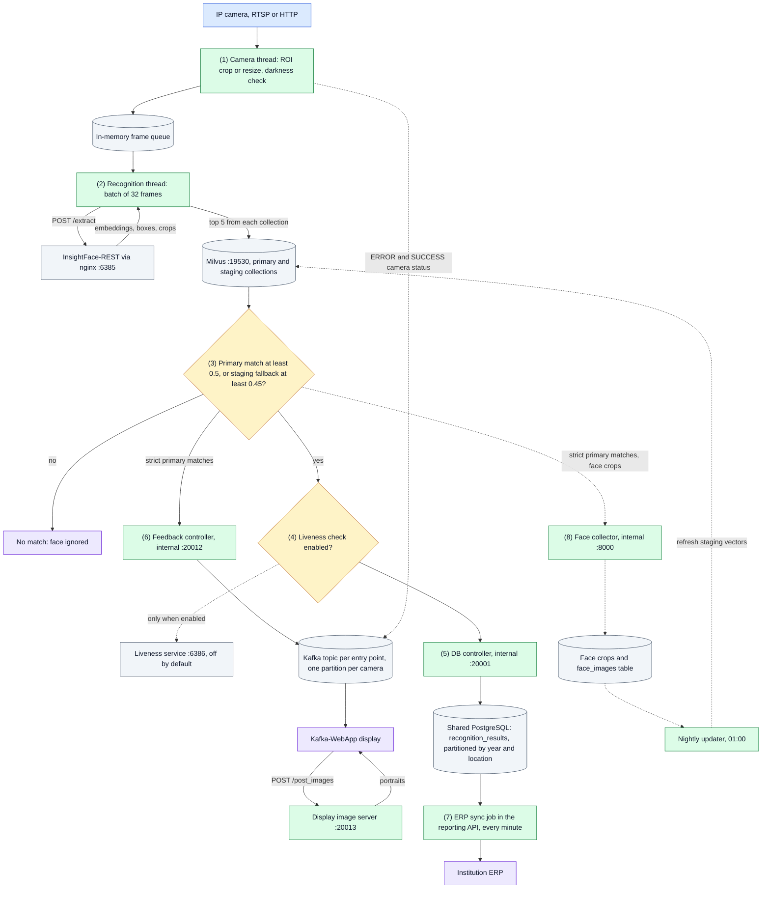
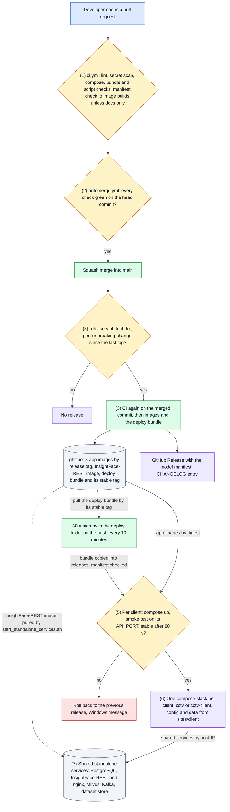

# CCTV Face Recognition Attendance System

Real-time, multi-camera face recognition that turns CCTV footage at campus gates, hostels and libraries into attendance records and posts them to each institution's ERP.

- **Detection and recognition:** [InsightFace-REST](https://github.com/SthPhoenix/InsightFace-REST) on a TensorRT backend: SCRFD (`scrfd_10g_gnkps`) for detection and ArcFace (`w600k_r50`) for 512-d embeddings, FP16. By default one container runs on GPU 0 behind an nginx proxy on port 6385 (D-032).
- **Identity search:** Milvus (GPU, `GPU_IVF_FLAT`, cosine) with a primary *enrolled* collection and a *staging* collection of faces captured from CCTV, used as a fallback to reduce the domain gap between enrollment photos and elevated-angle cameras.
- **Self-improving gallery:** a collector keeps each person's best face crops per camera cluster (pupil distance, match score), and a nightly job refreshes the staging vectors.
- **Outputs:** recognitions are stored in PostgreSQL (year and location partitions), synced to the institution's ERP every minute, exposed through a reporting API, and pushed over Kafka to on-site displays.

One deployment serves one or more clients, each with its own site folder and compose project (D-036).

## System Design

How to read it: solid arrows are the path every recognition takes; dotted arrows are optional, cached or written on the side. Colors follow [docs/FLOW.md](docs/FLOW.md#how-to-read-the-diagrams): blue the way in, green a code step, amber a decision, purple an outcome, grey a data store or outside service.



1. **Camera input.** The producer process starts one thread per configured camera. Each thread reads frames, crops the camera's ROI polygon or resizes the frame to 640x360, and queues it with the camera name. When 80 of the last 100 frames are dark, the thread stops queueing and sends an `ERROR` message straight to the camera's Kafka partition, so the display can tell people why nothing is recognized.
2. **Detection and embeddings.** Four recognition threads take 32 frames at a time from the in-memory queue and send them to InsightFace-REST through nginx. The queue keeps frames off the network and out of Kafka; it is lost on restart.
3. **Identity search.** Every face is searched against both Milvus collections. A face is accepted when its best primary hit scores at least 0.5 (cosine). Otherwise, with `STAGING = True`, the best primary hit that also appears in the staging top 5 is accepted at 0.45 or more. Staging vectors come from CCTV crops, so they help people whose enrollment photos differ from how the cameras see them.
4. **Liveness.** Anti-spoofing exists but is off (`ENABLE_FACE_LIVENESS_DETECTION = False`). When on, a person whose crops look spoofed more often than real is dropped from the attendance records; the display and the collector still receive that person.
5. **Attendance record.** Accepted faces, with the annotated frame, go to the DB controller, which answers at once and writes to PostgreSQL in the background. Each record lands in a partition for its year and location.
6. **Display.** Strict primary matches go over TCP to the feedback controller, which publishes each person ID to the entry point's Kafka topic, on the camera's partition. Kafka-WebApp (v0.3.0) reads every partition of the topic, so every camera of the entry point, asks the display image server for portraits, and shows them. Camera `ERROR` and `SUCCESS` messages go to a per-camera status strip on the display instead. Staging matches are recorded but not displayed.
7. **ERP.** Every minute the reporting API posts the day's unacknowledged records to the location's ERP endpoint, and marks each one acknowledged when the ERP confirms it. The same service answers report queries.
8. **Gallery refresh.** Strict primary matches also send their face crops to the collector, which keeps the best three per person and camera cluster. At 01:00 the nightly updater embeds new crops and replaces that person's vectors in the staging collection.

Each step is traced in detail in [docs/FLOW.md](docs/FLOW.md).

## Solution Architecture

How to read it: solid arrows are what happens on every release; dotted arrows are optional or happen by hand.



1. **Continuous integration.** Every pull request runs `ci.yml`. The aggregate `ci` check passes only when lint, the gitleaks scan, the compose, bundle, layout and standalone-script checks, the model-manifest drift check and all eight image builds with their smoke tests pass. A pull request that changes only `docs/` or Markdown files skips the image builds, to save Actions minutes. A pull request that touches provisioning, the shared services' settings or the code that logs in to them also runs the client-isolation test on throwaway copies of the shared services. Beyond these self-checks and tests there are no unit tests (D-006).
2. **Auto-merge.** `automerge.yml` runs from main's copy after `ci` or the code-review workflow finishes. It squash-merges a non-draft pull request from this repository, and deletes its branch, only when every check on the latest commit passed (D-013, D-025). Green CI is the merge and ship gate; there is no human review step.
3. **Build and release.** After a merge, `release.yml` reads the merged pull request titles as Conventional Commits: `type!:` or a `BREAKING CHANGE` footer gives a major bump, `feat:` a minor one, `fix:` or `perf:` a patch, and anything else no release. It re-runs CI on the exact commit, pushes the eight app images, including the ROI page, to `ghcr.io/hamza-aziz-ai/cctv-face-recognition-<service>:<tag>`, builds the InsightFace-REST image if its source changed, and publishes the deploy bundle (D-033). Only then does it tag, create the GitHub Release with `mlops/model-manifest.json`, move the bundle's `stable` tag and add the notes to `CHANGELOG.md`. A failed release opens an issue for the owner (D-014, D-017, D-029). **Pull request titles must follow this convention.**
4. **Watcher.** `watch.py` runs through Windows Task Scheduler from a deploy folder that holds no repository and no GitHub login, only a pull-only registry login (D-033, D-034). It pulls the deploy bundle's `stable` tag, which only `release.yml` moves, and reads the release from the image label. It serves every client folder under `sites\`, and deploys the release to a client only if it is not that client's current one and has not failed for it before. The owner installs `watch.py` by hand from a bundle; it never replaces itself. Starting automerge for green pull requests left open is a separate script, `deploy/nudge_automerge.py`, which runs only on the owner's laptop (D-029).
5. **Deploy check.** The watcher copies the bundle out of its image with `docker create` and `docker cp`, without running it, into `releases\<tag>\`, and refuses it unless its manifest is for that release and pins every image to one of ours by digest. For each client it then runs `docker compose -p <project> --project-directory sites\<client> up --pull missing --no-build --wait` with the bundle's compose file, waits for the client's API (`API_PORT` in its `.env`, 9090 by default) to answer, then checks that no service is restarting or exited 90 seconds later. On failure it starts that client's previous release from its bundle, records the failed tag for that client so it is never retried unattended, and shows a Windows message; other clients are not touched. A registry login problem, a site-config problem, or a folder whose `master.env` names a different `CLIENT_ID`, stops deploys with a single message. See [docs/ROLLBACK.md](docs/ROLLBACK.md). On every run it tags the release's images, which compose pulled by digest, and drops their digest names, so Docker Desktop shows no `<none>` rows.
6. **Live stack.** The main compose stack runs seven application containers and Kafka-WebApp, plus the ROI page on demand. It is compose project `cctv` for the owner and `cctv-<client>` for any other client, with no fixed container names and its own network: the DB controller, feedback controller and face collector are reached by service name and not published on the host (D-036). Config and data come from the client's folder `sites\<client>\` in the deploy folder, so a new release changes only images and compose files. The watcher never starts a stack the owner stopped, and keeps only the bundles and images of each client's current and previous releases.
7. **Standalone services.** PostgreSQL, InsightFace-REST, Milvus, Kafka and the dataset store are shared by every client stack on the host and run as separate compose stacks or containers, started by `start_standalone_services.sh`. The watcher does not manage them; they change only when someone runs that script. On a deployment host the script runs from a release bundle, with `CONFIG_DIR` pointing at the site folder.

Who owns which part, and the runtime ports, are in [docs/ARCHITECTURE.md](docs/ARCHITECTURE.md).

## Quick start

### Prerequisites

- A Linux host, or Windows with Docker Desktop, with Docker Compose and the NVIDIA Container Toolkit.
- An NVIDIA GPU. The defaults in `STANDALONE-SERVICES/standalone-services.env` put every GPU service on GPU 0 with small batches (tested on a 6 GB laptop GPU). A larger or multi-GPU host sets its own GPUs and batch sizes in a profile file under `STANDALONE-SERVICES/hosts/`, chosen by `HOST_PROFILE` in `.env` (D-015, D-032). No profile is committed today.
- [DVC](https://dvc.org/doc/install) access to the face datasets.

### 1. Clone

```bash
git clone --recurse-submodules git@github.com:hamza-aziz-ai/CCTV-Face-Recognition-Attendance-System.git
cd CCTV-Face-Recognition-Attendance-System
find . -type f -name "*.sh" -exec chmod +x {} \;
```

### 2. Configure

Secrets are not stored in this repository. Copy the template and fill in the values; Docker Compose reads `.env` from the project root.

```bash
cp .env.example .env
```

| Variable                                                                                                                                                           | Used by                                                                                                                                                     |
|--------------------------------------------------------------------------------------------------------------------------------------------------------------------|-------------------------------------------------------------------------------------------------------------------------------------------------------------|
| `POSTGRES_USER`, `POSTGRES_PASSWORD`                                                                                                                               | Admin login of the shared PostgreSQL. App services use it only on the owner's site while `LEGACY_SHARED_SERVICES=1`                                         |
| `PG_APP_USER`, `PG_APP_PASSWORD`, `MILVUS_APP_USER`, `MILVUS_APP_PASSWORD`, `KAFKA_APP_USER`, `KAFKA_APP_PASSWORD`, `KAFKA_DISPLAY_USER`, `KAFKA_DISPLAY_PASSWORD` | This client's own logins on the shared services, written by `deploy/provision.py` (D-037); each service gets only those it uses, and a missing one stops it |
| `POSTGRES_HOST_PORT`                                                                                                                                               | Host port for PostgreSQL when 5432 is taken; default 5432                                                                                                   |
| `API_KEY`                                                                                                                                                          | Reporting API (`?api_key=` query parameter)                                                                                                                 |
| `CAM_USERNAME`, `CAM_PASSWORD`                                                                                                                                     | Default camera credentials                                                                                                                                  |
| `API_PORT`, `DISPLAY_IMAGE_PORT`, `DISPLAY_PORT`, `ROI_PORT`                                                                                                       | Published ports of this client's stack, defaults 9090, 20013, 9095 and 8069; only a second client on the same host needs them                               |
| `HOST_PROFILE`                                                                                                                                                     | Optional GPU profile under `STANDALONE-SERVICES/hosts/`                                                                                                     |
| `DATASET_STORE_USER`, `DATASET_STORE_PASSWORD`, `DATASET_STORE_DIR`                                                                                                | Dataset store (MinIO DVC remote): root login and the host folder holding the data, outside the repo                                                         |

The camera configuration is git-ignored. Create it from the template:

```bash
cp src/Camera-Configuration/camera_configuration.example.json src/Camera-Configuration/camera_configuration.json
```

Each location has an ERP `api-endpoint` and a set of `cctv-cameras` grouped by entry point (for example `entry` and `exit`). Each camera has `ip_address`, `port`, `endpoint`, `username`, `password` and an optional ROI polygon in `masking-coordinates`. A camera whose `username` or `password` is `null` falls back to `CAM_USERNAME` and `CAM_PASSWORD`. Camera keys end in a number (`cctv-camera-1`), which sets the camera's Kafka partition. To draw a camera's ROI polygon, start the ROI page with `docker compose -f docker-compose-main.yml --profile roi up -d roi-provisioning` and open http://localhost:8069 (`ROI_PORT` if set). Pick a camera, load a full-resolution snapshot, click around the area to keep, preview the crop (made with the producer's own `crop_and_mask_roi`), and save: the points go into that camera's `masking-coordinates`. Restart the producer-consumer to apply them, and stop the page afterwards (`docker compose -f docker-compose-main.yml --profile roi stop roi-provisioning`). It listens on this host only and has no login (D-035). Without Docker, `Custom-ROI-Provisioning/crop_rectangle.py` with `RTSP_URL` set prints the same kind of points to copy in by hand.

Runtime parameters such as batch size, thresholds, ports and the staging and liveness flags live in [`src/parameters.py`](src/parameters.py). At startup `set_configuration.sh` writes the host IP to `master.env` (created from `master.env.example`, not tracked). The standalone stacks read it from there too, so no tracked file changes. InsightFace-REST models, batch sizes and GPU devices are set in `standalone-services.env`. `master.env` also names the client the site serves, `CLIENT_ID` (D-036): every service refuses to start without a valid one, and `CLIENT_ID=owner` keeps the database and collection names used before; other clients get their own ([DATA.md](docs/DATA.md)). Each client logs in to the shared services with its own accounts from its `.env`. Until its cutover (D-037), the owner's site sets `LEGACY_SHARED_SERVICES=1` in `master.env`, which keeps the admin PostgreSQL login, no Milvus or Kafka login, unprefixed topics, and databases and topics created at start; any other client that sets it is refused.

### 3. Get the datasets

The face datasets are versioned with DVC, not git. The default remote `minio` is the dataset store started by `start_standalone_services.sh` (bucket `dvc`, S3 API on port 9010, D-019). The datasets were restarted from scratch in October 2026 (D-026).

| DVC file                         | Contents                                                |
|----------------------------------|---------------------------------------------------------|
| `FACIAL-RECOGNITION-DATASET.dvc` | Enrollment photos and each person's `vectors.parquet`   |
| `DISPLAY-FACE-DATASET.dvc`       | Portraits shown on the displays (`<id>/front_face.jpg`) |

```bash
# Credentials stay in .dvc/config.local (git-ignored); use the DATASET_STORE_* values from .env
dvc remote modify --local minio access_key_id <DATASET_STORE_USER>
dvc remote modify --local minio secret_access_key <DATASET_STORE_PASSWORD>
# On any machine other than the dataset store host, point at that host
dvc remote modify --local minio endpointurl http://<store-host>:9010
dvc pull
```

To add data, run `dvc add FACIAL-RECOGNITION-DATASET`, commit the updated `.dvc` file, then `dvc push`.

### 4. Build and start

```bash
docker compose -f docker-compose-main.yml -f docker-compose.dev.yml build   # build the application images
./start_complete_project.sh     # shared standalone stacks, including PostgreSQL, then the main compose stack
```

To start in two steps instead, run `./start_standalone_services.sh`, then `docker-compose -f docker-compose-main.yml up -d`.

The standalone scripts also run from a release bundle, with the site's config in a separate folder: `CONFIG_DIR=<site folder> bash <bundle>/start_standalone_services.sh`. They then read `.env` and `master.env` from that folder and keep the InsightFace-REST models and TensorRT engines in `<site folder>/insightface-models`, so a new release does not rebuild them.

The images contain the application source, so rebuild them after code changes. For development, start with both files (`docker compose -f docker-compose-main.yml -f docker-compose.dev.yml up -d`): `docker-compose.dev.yml` mounts `./src` over the baked copy in every service except the producer-consumer and the ROI page, so edits to those services apply on restart without a rebuild. Those two always run the code in their image.

### 5. Enroll faces

Put each person's photos in `FACIAL-RECOGNITION-DATASET/<person_id>/`: `front.jpg`, `chin_up.jpg`, `chin_down.jpg`, `left_30.jpg` and `right_30.jpg`, plus the same five with `_glasses` for someone who wears glasses. Get each person's written consent first: these are biometric data.

```bash
python3 src/util/enrol_person.py FACIAL-RECOGNITION-DATASET/<person_id>
```

Nothing is enrolled unless every photo passes the checks. The script saves the vectors next to the photos and publishes a new version of the primary collection (D-026, D-030). Then version the dataset: `dvc add FACIAL-RECOGNITION-DATASET`, commit the `.dvc` file, `dvc push`. Run `python3 src/util/face_vectors.py migrate` once before the first enrollment on an existing install. The checks, version switching and the scripts for whole groups are described in [docs/FLOW.md](docs/FLOW.md#7-enrollment-and-face-vector-publishing).

### Stop

```bash
./stop_complete_project.sh
```

This also stops the standalone stacks: InsightFace-REST, Milvus, Kafka, PostgreSQL and the dataset store.

## Documentation

| Document                                    | What it covers                                                                                                        |
|---------------------------------------------|-----------------------------------------------------------------------------------------------------------------------|
| [ARCHITECTURE.md](docs/ARCHITECTURE.md)     | Modules and what they own; runtime topology with ports; how a change reaches production; where data lives; deployment |
| [FLOW.md](docs/FLOW.md)                     | Each flow step by step: startup, recognition, records, display, ERP and reports, gallery, enrollment, release         |
| [DATA.md](docs/DATA.md)                     | Every data store: shape, size, writers, readers and trade-offs                                                        |
| [DECISIONS.md](docs/DECISIONS.md)           | Decision records, D-001 onward                                                                                        |
| [ALTERNATIVES.md](docs/ALTERNATIVES.md)     | Options considered and not taken                                                                                      |
| [THREAT.md](docs/THREAT.md)                 | Threat model: entry points, abuse, gaps and what to close first                                                       |
| [FAILURE.md](docs/FAILURE.md)               | How each component fails and what happens then                                                                        |
| [ROLLBACK.md](docs/ROLLBACK.md)             | How to undo a release, a data change or a standalone service change                                                   |
| [CUTOVER-D037.md](docs/CUTOVER-D037.md)     | Runbook: switching a host to per-client logins on the shared services, and rolling it back                            |
| [TEST-CHECKLIST.md](docs/TEST-CHECKLIST.md) | Live checks after a deploy or rollback                                                                                |
| [CONSTRAINTS.md](docs/CONSTRAINTS.md)       | Fixed limits the design works within                                                                                  |
| [ALLOW-POLICY.md](docs/ALLOW-POLICY.md)     | What automation may do without asking                                                                                 |
| [ASSUMPTIONS.md](docs/ASSUMPTIONS.md)       | Assumptions not yet proven                                                                                            |
| [DEPENDENCIES.md](docs/DEPENDENCIES.md)     | External dependencies and secrets                                                                                     |
| [DEFENSE.md](docs/DEFENSE.md)               | Defense brief                                                                                                         |
| [HANDOVER.md](docs/HANDOVER.md)             | Session handover notes, newest first                                                                                  |
| [Kafka-WebApp](Kafka-WebApp/README.md)      | Display client setup, kept in its own repository                                                                      |

## Known issues and limitations

- The duplicate check in `src/database_server/postgresql_database.py` queries a `recognition_timestamp` column that the table does not define, and puts a `%s` placeholder inside a quoted interval. Recognition inserts fail unless the live table was migrated by hand.
- nginx forwards to one InsightFace-REST container only; more containers from `INSIGHTFACE_GPUS` start but are not balanced (D-032).
- Face liveness detection is off, so a printed photo can be recognized.
- The nightly updater replaces all of a person's staging vectors with only that night's new crops, and still marks crops processed when the Milvus insert fails.
- Face clusters are defined only for the `maingate` entry and exit cameras, so the face collector rejects crops from other cameras.
- The app's own services (DB controller, feedback controller, face collector, display image server and display) and InsightFace-REST have no login, and the reporting API's single key travels in the query string; the shared PostgreSQL, Milvus, Kafka and dataset store have per-client logins since D-037. See [docs/THREAT.md](docs/THREAT.md).
- Client separation (D-036): steps 1 to 3 are built. Each client has its own `CLIENT_ID`, names in the shared services, compose project, site folder, and logins on PostgreSQL, Milvus, Kafka and the dataset store, made by `deploy/provision.py` (D-037). Each host switches once, by hand, with the runbook [docs/CUTOVER-D037.md](docs/CUTOVER-D037.md); until then the owner's site keeps `LEGACY_SHARED_SERVICES=1`. User accounts and protected callers (step 4), and tiers and recovery (step 5) are planned.
- The ROI page has no login; it is bound to 127.0.0.1 and runs only when started with the `roi` profile (D-035).

## Authors

Developed by **Hamza Aziz**.

Third-party components:

- [InsightFace-REST](https://github.com/SthPhoenix/InsightFace-REST) (`STANDALONE-SERVICES/InsightFace-REST`)
- [Silent-Face-Anti-Spoofing](https://github.com/minivision-ai/Silent-Face-Anti-Spoofing) (`STANDALONE-SERVICES/Face-Liveness-Detection/src`)
