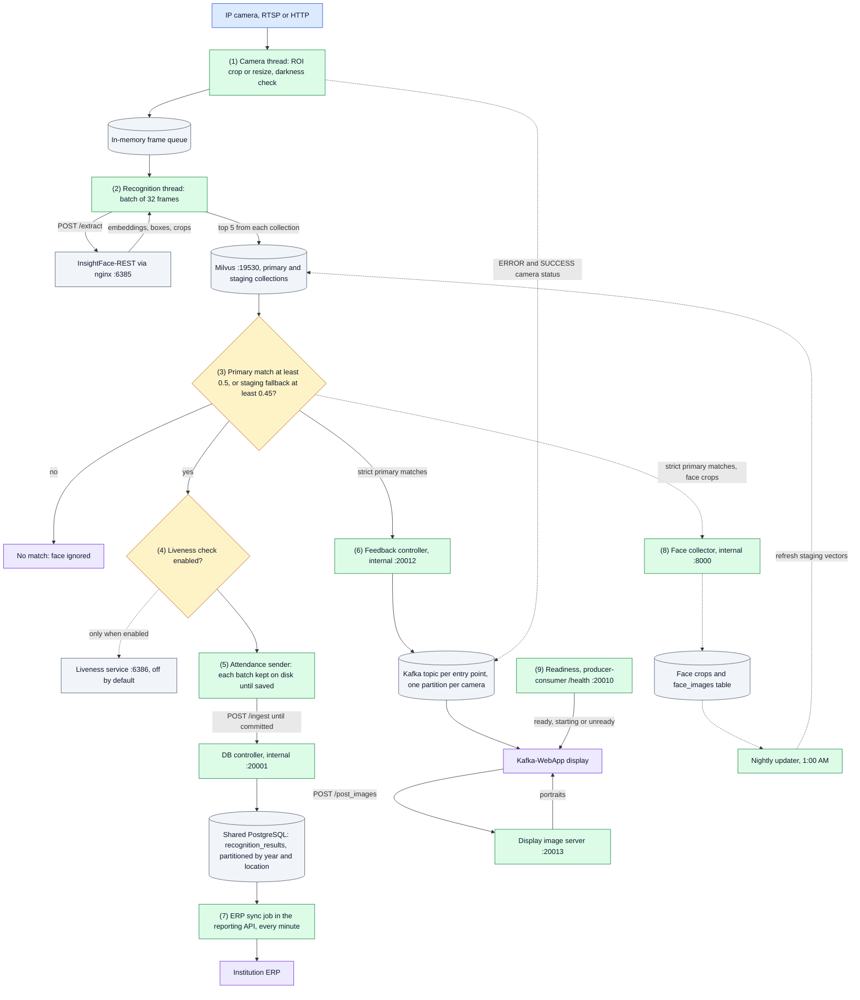
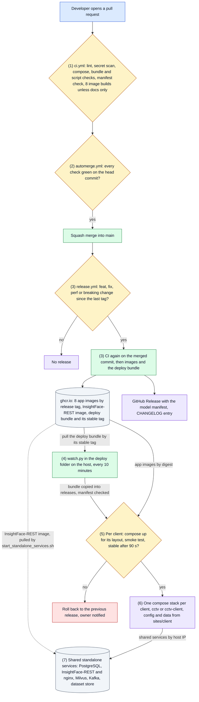

<div align="center">

# CCTV Face Recognition Attendance System

**Turn the CCTV cameras an institution already has into a hands-free attendance register.**

Real-time, multi-camera face recognition on GPU, from campus gates, hostels and libraries to each institution's ERP, with live displays, an admin website and per-client isolation.

[](https://github.com/hamza-aziz-ai/CCTV-Face-Recognition-Attendance-System/actions/workflows/ci.yml)


[Overview](#overview) · [Results](#measured-results) · [Website](#the-website) · [Deployment](#deployment-options) · [System design](#system-design) · [Quick start](#quick-start) · [Security](#security-and-privacy) · [Docs](#documentation)

</div>

---

## Overview

Cameras stream to a GPU pipeline that finds every face, matches it against the enrolled people, and records attendance once per person and camera in any 5 minutes. Records go to PostgreSQL, to the institution's ERP every minute, and to the on-site displays as people pass, while an admin website shows live video and lets admins mark the part of each picture that matters.

| | Capability | How |
|---|---|---|
| 🎯 | **Accurate recognition** | SCRFD-10G detection and ArcFace `w600k_r50` 512-d embeddings on TensorRT FP16, through [InsightFace-REST](https://github.com/SthPhoenix/InsightFace-REST) |
| 🔎 | **Fast identity search** | Milvus on GPU (`GPU_IVF_FLAT`, cosine) with an *enrolled* collection and a *staging* collection of CCTV crops that closes the gap between enrolment photos and elevated cameras |
| 🔁 | **Gets better on its own** | The best face crops per person and camera group are kept, and a nightly job refreshes the staging vectors |
| 🛡️ | **No lost attendance** | Every batch is written to disk before it is sent and deleted only once the database confirms it, so restarts and power cuts lose nothing (D-051) |
| 📺 | **Live feedback** | Recognitions reach Kafka-WebApp displays at each entry point, with per-camera status: dark picture, unreachable camera, region no longer fits |
| 🩺 | **Honest health** | "Ready" means cameras are read, recognition works and attendance is saved, not just that ports answer (D-051) |
| 🏢 | **Multi-client** | One codebase serves a client's own host or many clients on a central host, each with its own stack, data, logins and website (D-036, D-037) |
| 📡 | **Edge capable** | A Jetson Orin can capture and recognise a client's cameras on site while the central host keeps the data and the website (D-052) |
| 🚀 | **Ships itself** | Green CI merges, releases and deploys by itself, and rolls back on failure (D-013, D-016, D-033) |

## Measured results

| What | Result | Basis |
|---|---|---|
| Recognition at the 0.5 match threshold | **99.35 %** correct, **0** wrong-person matches, **0** of 1,000 never-enrolled people accepted | LFW: 311 people, 3,870 probe photos, live InsightFace-REST, 2026-11-06. Not CCTV footage ([ASSUMPTIONS.md](docs/ASSUMPTIONS.md)) |
| Right person ranked first | **99.84 %** of probes | Same run, regardless of threshold |
| Edge node throughput | 1, 2 and 4 cameras: **28, 60 and 108** records a minute | Jetson Orin Nano, one phone stream fed as several cameras, 2026-11-02 |
| Edge recognition parity | Embeddings match the laptop's at cosine **≥ 0.9955** | 119 faces through the Jetson's InsightFace-REST |
| Recovery | Edge stopped, display showed "Cannot Reach" in **7 s**; back to ready **11 s** after start | Live edge proof, 2026-11-06 |

## The website

Each client has its own site behind one HTTPS proxy per host, `https://<client>.localhost` or `SITE_HOST` from its `.env` (D-040). Pages share one top menu.

| Page | Path | Who |
|---|---|---|
| Display | `/` | Any signed-in account |
| Live view: each camera on demand, with its latest recognitions | `/api/live` | `client_admin`, `viewer` |
| Camera regions: draw, move and scale each camera's region of interest | `/roi/` | `client_admin` |
| Sign in | `/auth/sign-in` | Everyone |
| Readiness for displays outside the stack | `/health` | Open; answers only starting, ready or unready and reason codes |

## Deployment options

| Option | Where things run | Use it when |
|---|---|---|
| **Dedicated** | Everything on the client's own GPU host | The client keeps all data on site |
| **Central** | Many clients on one GPU host, one compose project and site folder each, shared PostgreSQL, Milvus, Kafka and dataset store with per-client logins | Several smaller clients share hardware (D-036, D-037) |
| **Edge + central** | A Jetson captures and recognises on site; the central host keeps the database, the face crops, the website and the display | Cameras are far from the GPU host, or bandwidth is scarce (D-052) |

A client's tier is set by the owner: the standard image today, with an optional DeepStream tier planned (D-041).

## System Design

How to read it: solid arrows are the path every recognition takes; dotted arrows are optional, cached or written on the side. Colors follow [docs/FLOW.md](docs/FLOW.md#how-to-read-the-diagrams): blue the way in, green a code step, amber a decision, purple an outcome, grey a data store or outside service.



<details>
<summary><b>The nine steps, in detail</b></summary>

1. **Camera input.** The producer process starts one thread per configured camera. Each thread reads frames, crops the camera's ROI polygon or resizes the frame to 640x360, and queues it with the camera name. When 80 of the last 100 frames are dark, judged on the region's own pixels, the thread stops queueing and sends an `ERROR` message straight to the camera's Kafka partition, so the display can tell people why nothing is recognized. A region that no longer fits the camera's picture, and a camera that does not answer, are reported the same way; an unreachable camera is retried every 35 s.
2. **Detection and embeddings.** Four recognition threads take 32 frames at a time from the in-memory queue and send them to InsightFace-REST through nginx. The queue keeps frames off the network and out of Kafka; it is lost on restart.
3. **Identity search.** Every face is searched against both Milvus collections. A face is accepted when its best primary hit scores at least 0.5 (cosine). Otherwise, with `STAGING = True`, the best primary hit that also appears in the staging top 5 is accepted at 0.45 or more. Staging vectors come from CCTV crops, so they help people whose enrollment photos differ from how the cameras see them.
4. **Liveness.** Anti-spoofing exists but is off (`ENABLE_FACE_LIVENESS_DETECTION = False`). When on, a person whose crops look spoofed more often than real is dropped from the attendance records; the display and the collector still receive that person.
5. **Attendance record.** Accepted faces, with the annotated frame, go to the attendance sender, which writes each batch to disk before sending it, so no restart loses it. It sends the batch to the DB controller until the controller confirms it is saved, and deletes it only then. The controller saves a batch whole or not at all and answers only after the commit; a record already saved is skipped, so a batch sent again is never saved twice. Each record lands in a partition for its year and location (D-051).
6. **Display.** Strict primary matches go over TCP to the feedback controller, which publishes each person ID to the entry point's Kafka topic, on the camera's partition. Kafka-WebApp, pinned in `docker-compose-main.yml`, reads every partition of the topic, so every camera of the entry point, asks the display image server for portraits, and shows them, or silhouettes when there are none. Camera `ERROR` and `SUCCESS` messages go to a per-camera status strip on the display instead. Staging matches are recorded but not displayed.
7. **ERP.** Every minute the reporting API posts the day's unacknowledged records to the location's ERP endpoint, and marks each one acknowledged when the ERP confirms it. The same service answers report queries.
8. **Gallery refresh.** Strict primary matches also send their face crops to the collector, which keeps the best three per person and camera cluster, taken from the camera configuration. An edge node sends its crops through the central API with an `edge_collector` machine token (D-043). At 1:00 AM the nightly updater embeds new crops and replaces that person's vectors in the staging collection.
9. **Readiness.** producer-consumer answers `GET /health` with starting, ready or unready and reason codes only. It is ready while every camera and recognition thread keeps making progress, batches succeed, attendance is confirmed saved and InsightFace, Milvus, Kafka and both controllers pass their checks. The display shows the system up only while it says ready, and Docker's healthcheck reads it too. A worker that dies stops the container, so Docker starts it again (D-051).

Each step is traced in detail in [docs/FLOW.md](docs/FLOW.md).

</details>

## Solution Architecture

How to read it: solid arrows are what happens on every release; dotted arrows are optional or happen by hand.



<details>
<summary><b>The release path, in detail</b></summary>

1. **Continuous integration.** Every pull request runs `ci.yml`. The aggregate `ci` check passes only when lint, the gitleaks scan, the compose, bundle, layout and standalone-script checks, the model-manifest drift check and all eight image builds with their smoke tests pass. A pull request that changes only `docs/` or Markdown files skips the image builds, to save Actions minutes, and renders every Mermaid diagram instead. A pull request that touches provisioning, the shared services' settings or the code that logs in to them also runs the client-isolation test on throwaway copies of the shared services.
2. **Auto-merge.** `automerge.yml` runs from main's copy after `ci` or the code-review workflow finishes. It squash-merges a non-draft pull request from this repository, and deletes its branch, only when every check on the latest commit passed (D-013, D-025). Green CI is the merge and ship gate; there is no human review step.
3. **Build and release.** After a merge, `release.yml` reads the merged pull request titles as Conventional Commits: `type!:` or a `BREAKING CHANGE` footer gives a major bump, `feat:` a minor one, `fix:` or `perf:` a patch, and anything else no release. It re-runs CI on the exact commit, pushes the eight app images for amd64 and arm64 to `ghcr.io/hamza-aziz-ai/cctv-face-recognition-<service>:<tag>`, builds the InsightFace-REST image if its source changed, and publishes the deploy bundle (D-033, D-044). Only then does it tag, create the GitHub Release with `mlops/model-manifest.json`, move the bundle's `stable` tag and add the notes to `CHANGELOG.md`. A failed release opens an issue for the owner (D-014, D-017, D-029). **Pull request titles must follow this convention.**
4. **Watcher.** `watch.py` runs on a schedule (Windows Task Scheduler, or a systemd timer on a Jetson) from a deploy folder that holds no repository and no GitHub login, only a pull-only registry login (D-033, D-034). It pulls the deploy bundle's `stable` tag, which only `release.yml` moves, and serves every client folder under `sites/`. It deploys a release to a client only if it is not that client's current one and has not failed for it before. The owner installs `watch.py` by hand from a bundle; it never replaces itself.
5. **Deploy check.** The watcher copies the bundle out of its image without running it, into `releases/<tag>/`, and refuses it unless its manifest is for that release and pins every image to one of ours by digest. For each client it runs `docker compose up --wait` with the compose files of the client's layout (`full`, `central` or `edge`, D-052), waits for its API to answer, then checks that nothing restarts within 90 seconds. On failure it starts that client's previous release, records the failed tag so it is never retried unattended, and notifies the owner; other clients are not touched. A release that does not offer the client's layout is refused, rollback included. See [docs/ROLLBACK.md](docs/ROLLBACK.md).
6. **Live stack.** The main compose stack runs eight application containers, the camera region page among them, and Kafka-WebApp. It is compose project `cctv` for the owner and `cctv-<client>` for any other client, with no fixed container names and its own network (D-036). Config and data come from the client's folder `sites/<client>/`, so a new release changes only images and compose files. The watcher never starts a stack the owner stopped.
7. **Standalone services.** PostgreSQL, InsightFace-REST, Milvus, Kafka and the dataset store are shared by every client stack on the host and started by `start_standalone_services.sh`. The watcher does not manage them. On a deployment host the script runs from a release bundle, with `CONFIG_DIR` pointing at the site folder.

Who owns which part, and the runtime ports, are in [docs/ARCHITECTURE.md](docs/ARCHITECTURE.md).

</details>

## Quick start

> [!NOTE]
> **You need:** Docker with Compose and the NVIDIA Container Toolkit (Linux, or Windows with Docker Desktop), an NVIDIA GPU (the defaults fit a 6 GB laptop GPU), and [DVC](https://dvc.org/doc/install) access to the face datasets. Larger or multi-GPU hosts pick a profile under `STANDALONE-SERVICES/hosts/` with `HOST_PROFILE` (D-015, D-032).

**1. Clone**

```bash
git clone --recurse-submodules git@github.com:hamza-aziz-ai/CCTV-Face-Recognition-Attendance-System.git
cd CCTV-Face-Recognition-Attendance-System
find . -type f -name "*.sh" -exec chmod +x {} \;
```

**2. Configure.** Secrets never live in the repository: copy the templates and fill them in.

```bash
cp .env.example .env
cp src/Camera-Configuration/camera_configuration.example.json src/Camera-Configuration/camera_configuration.json
```

<details>
<summary><b>What goes in <code>.env</code> and the camera configuration</b></summary>

| Variable | Used by |
|---|---|
| `POSTGRES_USER`, `POSTGRES_PASSWORD` | Admin login of the shared PostgreSQL. App services use it only on the owner's site while `LEGACY_SHARED_SERVICES=1` |
| `PG_APP_USER`, `PG_APP_PASSWORD`, `MILVUS_APP_USER`, `MILVUS_APP_PASSWORD`, `KAFKA_APP_USER`, `KAFKA_APP_PASSWORD`, `KAFKA_DISPLAY_USER`, `KAFKA_DISPLAY_PASSWORD` | This client's own logins on the shared services, written by `deploy/provision.py` (D-037); each service gets only those it uses, and a missing one stops it |
| `POSTGRES_HOST_PORT` | Host port for PostgreSQL when 5432 is taken; default 5432 |
| `CAM_USERNAME`, `CAM_PASSWORD` | Default camera credentials |
| `API_PORT`, `DISPLAY_IMAGE_PORT`, `DISPLAY_PORT` | Ports of this client's stack on this host only, defaults 9090, 20013 and 9095; only a second client on the same host needs them |
| `SITE_HOST` | The client's website host name; `<client>.localhost` by default |
| `HOST_PROFILE` | Optional GPU profile under `STANDALONE-SERVICES/hosts/` |
| `DATASET_STORE_USER`, `DATASET_STORE_PASSWORD`, `DATASET_STORE_DIR` | Dataset store (MinIO DVC remote): root login and the host folder holding the data, outside the repo |

Each location in the camera configuration has an ERP `api-endpoint` and a set of `cctv-cameras` grouped by entry point (for example `entry` and `exit`). Each camera has `ip_address`, `port`, `endpoint`, `username`, `password`, an optional region in `masking-coordinates`, and an optional `cluster` to group cameras for face crops. A camera whose `username` or `password` is `null` falls back to `CAM_USERNAME` and `CAM_PASSWORD`. Camera keys end in a number (`cctv-camera-1`), which sets the camera's Kafka partition. Draw regions on the website's **Camera regions** page; a saved region applies after producer-consumer and the two controllers restart.

Runtime parameters such as batch size, thresholds, ports and the staging and liveness flags live in [`src/parameters.py`](src/parameters.py). At startup `set_configuration.sh` writes the host IP to `master.env` (created from `master.env.example`, not tracked). `master.env` also names the client the site serves, `CLIENT_ID` (D-036): every service refuses to start without a valid one, and `CLIENT_ID=owner` keeps the database and collection names used before; other clients get their own ([DATA.md](docs/DATA.md)).

</details>

**3. Get the datasets.** The face datasets are versioned with DVC; the default remote `minio` is the dataset store started with the shared services (bucket `dvc`, port 9010, D-019).

```bash
dvc remote modify --local minio access_key_id <DATASET_STORE_USER>
dvc remote modify --local minio secret_access_key <DATASET_STORE_PASSWORD>
dvc remote modify --local minio endpointurl http://<store-host>:9010   # on any machine other than the store host
dvc pull
```

**4. Build and start**

```bash
docker compose -f docker-compose-main.yml -f docker-compose.dev.yml build   # application images
./start_complete_project.sh     # shared services, including PostgreSQL, then the main stack
```

To start in two steps, run `./start_standalone_services.sh`, then `docker compose -f docker-compose-main.yml up -d`. For development, `docker-compose.dev.yml` mounts `./src` over the baked copy in every service except producer-consumer and the ROI page, so edits apply on restart without a rebuild.

**5. Create an account and sign in**

```powershell
docker exec -it cctv-mfr-api-service-1 python3 src/api/accounts.py add-user NAME client_admin
```

Roles are `client_admin`, `enrolment_operator` and `viewer`. Machines use `add-token NAME ROLE` and send `Authorization: Bearer <token>`; an edge node's token has the machine-only role `edge_collector`, which can only upload face crops. Trust the proxy's private certificate authority once per device:

```powershell
docker cp cctv-proxy:/data/caddy/pki/authorities/local/root.crt $env:TEMP\cctv-root.crt
certutil -user -addstore Root $env:TEMP\cctv-root.crt
```

**6. Enrol faces.** Get each person's written consent first: these are biometric data. Put their photos in `FACIAL-RECOGNITION-DATASET/<person_id>/` (`front`, `chin_up`, `chin_down`, `left_30`, `right_30`, plus `_glasses` versions for someone who wears glasses), then:

```bash
python3 src/util/enrol_person.py FACIAL-RECOGNITION-DATASET/<person_id>
```

Nothing is enrolled unless every photo passes the checks; then version the dataset with `dvc add`, commit and `dvc push`. The enrolment app (D-048) does the same through the API. Details are in [docs/FLOW.md](docs/FLOW.md#7-enrollment-and-face-vector-publishing).

**Stop** with `./stop_complete_project.sh`, which also stops the shared services.

## Security and privacy

- **Per-client isolation:** each client has its own compose project, site folder, databases, collections, topics and logins on every shared service (D-036, D-037), and its own accounts (D-039).
- **One way in:** a single HTTPS proxy per host fronts every client's website (D-040). Pages and the display need a session, reports are under `/api/`, and the camera region page checks every request with the client's own API, admins only.
- **Sessions:** HttpOnly, Secure, SameSite cookies with CSRF tokens on writes; revocable machine tokens with narrow roles.
- **Consent and deletion:** enrolment records consent against the client's privacy notice, and withdrawal or leaving deletes the person's face data while keeping attendance records (D-048, D-050).
- **Supply chain:** releases pin every image by digest, and hosts refuse a bundle that does not (D-033).

The threat model, its gaps and what to close first are in [docs/THREAT.md](docs/THREAT.md).

## Known limitations

- nginx forwards to one InsightFace-REST container only; more containers from `INSIGHTFACE_GPUS` start but are not balanced (D-032).
- Face liveness detection is off, so a printed photo can be recognized.
- The nightly updater replaces a person's staging vectors with only that night's new crops.
- The app's internal services (DB controller, feedback controller, face collector) and InsightFace-REST have no login of their own; they are not published outside the host.
- An edge node owns all of its client's cameras; mixed central and edge capture, and several edge nodes per client, are not supported. The camera configuration is copied to the edge by hand (D-052).
- Recognition accuracy is measured on LFW, not yet on real CCTV footage.

## Documentation

| Document | What it covers |
|---|---|
| [ARCHITECTURE.md](docs/ARCHITECTURE.md) | Modules and what they own; runtime topology with ports; how a change reaches production; where data lives |
| [FLOW.md](docs/FLOW.md) | Each flow step by step: startup, recognition, records, display, ERP and reports, gallery, enrollment, release |
| [DATA.md](docs/DATA.md) | Every data store: shape, size, writers, readers and trade-offs |
| [DECISIONS.md](docs/DECISIONS.md) | 52 decision records, D-001 onward |
| [ALTERNATIVES.md](docs/ALTERNATIVES.md) | Options considered and not taken |
| [THREAT.md](docs/THREAT.md) | Threat model: entry points, abuse, gaps and what to close first |
| [FAILURE.md](docs/FAILURE.md) | How each component fails and what happens then |
| [ROLLBACK.md](docs/ROLLBACK.md) | How to undo a release, a data change or a standalone service change |
| [CUTOVER-D037.md](docs/CUTOVER-D037.md) | Runbook: switching a host to per-client logins on the shared services |
| [TEST-CHECKLIST.md](docs/TEST-CHECKLIST.md) | Live checks after a deploy or rollback |
| [features/jetson-arm64.md](docs/features/jetson-arm64.md) | The Jetson edge node: benchmarks, setup and the edge runbook |
| [features/live-view.md](docs/features/live-view.md) | The live view |
| [CONSTRAINTS.md](docs/CONSTRAINTS.md) · [ASSUMPTIONS.md](docs/ASSUMPTIONS.md) · [DEPENDENCIES.md](docs/DEPENDENCIES.md) | Fixed limits, unproven assumptions, external dependencies and secrets |
| [ALLOW-POLICY.md](docs/ALLOW-POLICY.md) · [DEFENSE.md](docs/DEFENSE.md) · [HANDOVER.md](docs/HANDOVER.md) · [TIMELINES.md](docs/TIMELINES.md) | What automation may do, the defense brief, handover notes, real delivery times |
| [Kafka-WebApp](Kafka-WebApp/README.md) | The display client, kept in its own repository |

## Authors

Developed by **Hamza Aziz**.

Built on [InsightFace-REST](https://github.com/SthPhoenix/InsightFace-REST) (`STANDALONE-SERVICES/InsightFace-REST`) and [Silent-Face-Anti-Spoofing](https://github.com/minivision-ai/Silent-Face-Anti-Spoofing) (`STANDALONE-SERVICES/Face-Liveness-Detection/src`).
