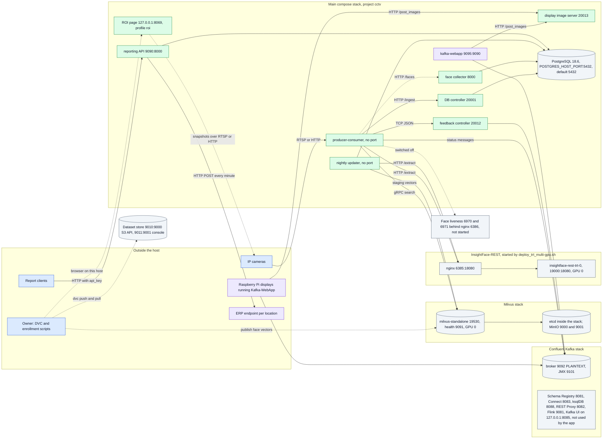
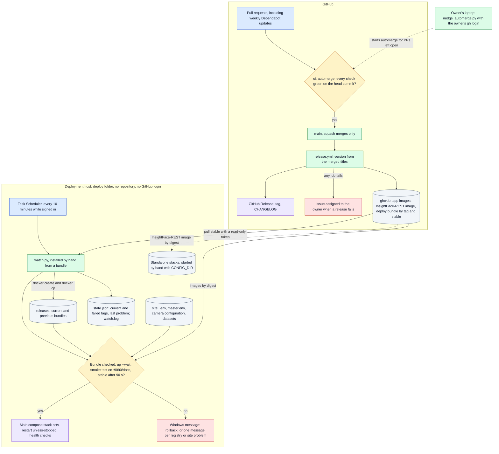
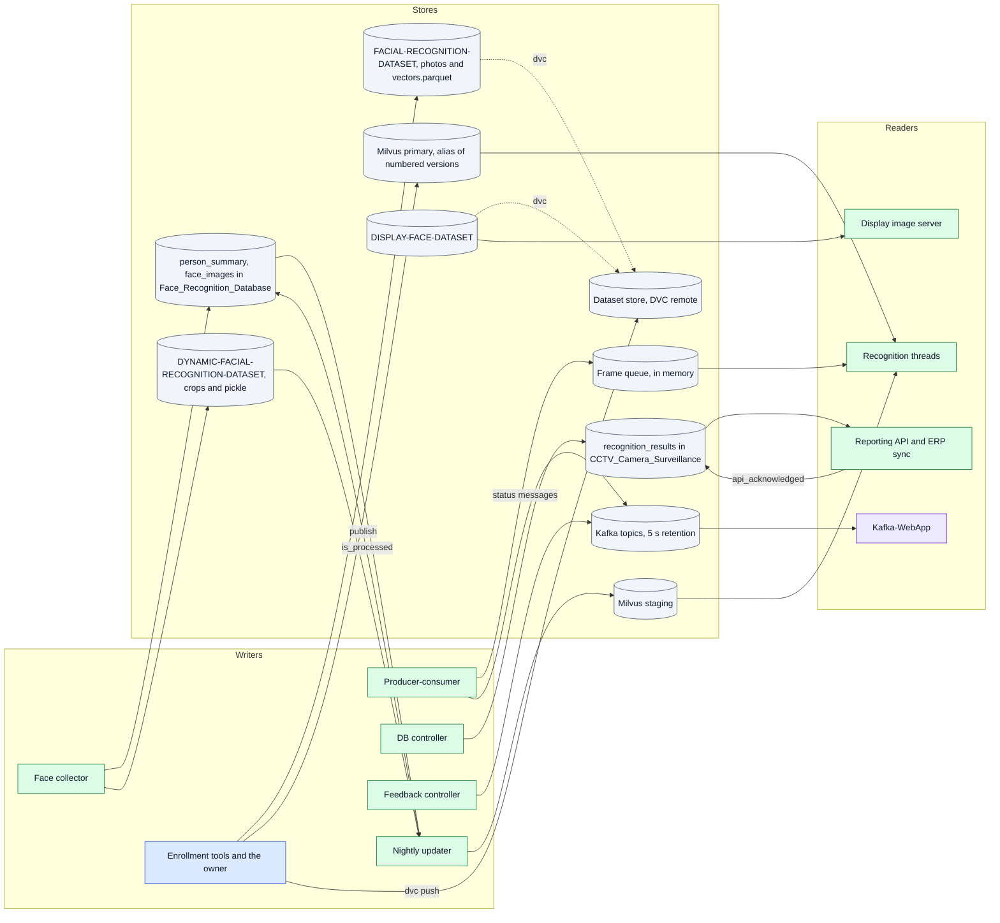

# Architecture

What exists, where it runs and who owns it. The system reads frames from IP cameras, recognizes faces, records attendance, posts it to each location's ERP and shows the result on displays. The overview is in the [README](../README.md#solution-architecture), execution order in [FLOW.md](FLOW.md), and the stored data in [DATA.md](DATA.md).

Checked against `main` at e9bf3fc. The latest release tag at that point was `v2.3.0`.

## Modules

| Module                 | Code                                                                                                                                                                                                                     | Runs as                                                                           | Owns                                                                                                        |
|------------------------|--------------------------------------------------------------------------------------------------------------------------------------------------------------------------------------------------------------------------|-----------------------------------------------------------------------------------|-------------------------------------------------------------------------------------------------------------|
| Producer-consumer      | `src/main.py`, `src/multicam_stream_producer.py`, `src/multicam_stream_consumer.py`, `src/insightface_face_detection.py`, `src/insightface_face_recognition.py`, `src/inference_data_cleaner.py`, `src/milvus_server.py` | `mfr-cctv-producer-consumer`, `main.Dockerfile`                                   | Camera threads, the frame queue, recognition threads, the match rules, camera status messages               |
| Runtime parameters     | `src/parameters.py`, `master.env`                                                                                                                                                                                        | Imported by every app service                                                     | Thresholds, batch size, ports, feature flags, the host IP                                                   |
| DB controller          | `src/database_server/`                                                                                                                                                                                                   | `mfr-database-controller`, `database-server.Dockerfile`, port 20001               | `CCTV_Camera_Surveillance`: creates it and writes recognition records                                       |
| Feedback controller    | `src/feedback_server/`                                                                                                                                                                                                   | `mfr-feedback-controller`, `feedback-server.Dockerfile`, port 20012               | Kafka topics and partitions; publishes recognitions to them                                                 |
| Reporting API          | `src/api/`                                                                                                                                                                                                               | `mfr-api-service`, `api.Dockerfile`, port 9090                                    | Report routes, the every-minute ERP sync, the `api_acknowledged` flag                                       |
| Display image server   | `src/fetch_face_image_server/`                                                                                                                                                                                           | `display-image-server`, `display-image.Dockerfile`, port 20013                    | Turns recognized IDs into portraits for displays                                                            |
| Face collector         | `src/dynamic_face_data_collector/`                                                                                                                                                                                       | `dynamic-face-dataset-collector`, port 8000                                       | `Face_Recognition_Database` and the collected face crops                                                    |
| Nightly updater        | `src/automatic-vector-db-updation/`                                                                                                                                                                                      | `automate-milvus-update`, `automatic-milvus-db-update.Dockerfile`                 | The Milvus staging collection and the dynamic embeddings pickle                                             |
| Enrollment tools       | `src/util/enrol_person.py`, `src/util/enrolment_checks.py`, `src/util/face_vectors.py`, `src/util/upload_embeddings.py`, `src/util/insightface_embeddings.py`                                                            | Run by hand                                                                       | Enrollment checks, `vectors.parquet` files, versions of the primary collection and its alias (D-026, D-030) |
| Camera configuration   | `src/Camera-Configuration/camera_configuration.json`, from the `.example.json` template; on a deployment host under `site\`                                                                                              | Mounted read-only into the app services, read-write into the ROI page             | Locations, ERP endpoints, cameras, credentials, ROI polygons                                                |
| ROI page               | `Custom-ROI-Provisioning/app.py` and `templates/index.html`, `roi.Dockerfile`; `Custom-ROI-Provisioning/crop_rectangle.py` is the desktop alternative                                                                    | `roi-provisioning`, compose profile `roi`, on 127.0.0.1:8069 only; off by default | Drawing ROI polygons                                                                                        |
| Kafka-WebApp           | `Kafka-WebApp` submodule, its own repository (D-024)                                                                                                                                                                     | `kafka-webapp` on this host (port 9095); same image on Raspberry Pis              | The display client                                                                                          |
| InsightFace-REST       | `STANDALONE-SERVICES/InsightFace-REST`, upstream with local patches (D-031)                                                                                                                                              | `insightface-rest-trt-<n>` containers and nginx, from `deploy_trt_multi-gpu.sh`   | Face detection and embeddings on the GPU                                                                    |
| Milvus                 | `STANDALONE-SERVICES/Milvus-Vector-Database`                                                                                                                                                                             | Compose stack: Milvus, etcd, MinIO                                                | Vector search                                                                                               |
| Kafka                  | `STANDALONE-SERVICES/Confluent-Kafka`                                                                                                                                                                                    | Compose stack, cp-all-in-one community 8.4.0 (D-021)                              | Recognition and status messages for displays                                                                |
| Dataset store          | `STANDALONE-SERVICES/Dataset-Store`                                                                                                                                                                                      | Compose stack, MinIO (`pgsty/minio`)                                              | DVC remote for the face datasets (D-019)                                                                    |
| Face liveness          | `STANDALONE-SERVICES/Face-Liveness-Detection`, `src/face_liveness_detection.py`                                                                                                                                          | Not started: commented out in `start_standalone_services.sh`                      | Anti-spoofing (MiniFASNet), switched off                                                                    |
| Start and stop scripts | `start_complete_project.sh`, `start_standalone_services.sh`, `set_configuration.sh`, `get_ip.sh`, `stop_*.sh`, tested by `deploy/test_standalone_scripts.sh`                                                             | Run by hand, from a checkout or from a release bundle with `CONFIG_DIR`           | Startup order and the host IP                                                                               |
| CI/CD                  | `.github/workflows/ci.yml`, `automerge.yml`, `release.yml`, `insightface-image.yml`, `.github/dependabot.yml`                                                                                                            | GitHub Actions                                                                    | The merge gate, versions, release images and the deploy bundle                                              |
| Model manifest         | `mlops/model-manifest.json`, `mlops/check_manifest.py`                                                                                                                                                                   | CI and release                                                                    | Pins models, thresholds and datasets together; fails on drift (D-012)                                       |
| Deploy bundle          | `deploy/make_bundle.py`, `deploy/bundle.Dockerfile`                                                                                                                                                                      | Release job; `stable` tag moved only by `release.yml`                             | The source-free set of files a host needs, with images pinned by digest (D-033)                             |
| Deployment watcher     | `deploy/watch.py`, `deploy/test_watch.py`                                                                                                                                                                                | Windows Task Scheduler in the deploy folder of the deployment host                | Deploys bundles from the registry, rolls back on failure (D-016, D-034)                                     |
| Automerge nudge        | `deploy/nudge_automerge.py`                                                                                                                                                                                              | Windows Task Scheduler on the owner's laptop only                                 | Deploys new releases, rolls back on failure, nudges automerge (D-016, D-029)                                |

## Color legend

All three views, and every diagram in FLOW.md, use the same colors:

| Color  | Meaning                                                    |
|--------|------------------------------------------------------------|
| Blue   | The way in: cameras, people and clients outside the system |
| Green  | Our code: an application container, script or workflow     |
| Amber  | A decision or gate                                         |
| Purple | An outcome someone can see: a display, the ERP, a release  |
| Red    | An error or failure path                                   |
| Grey   | A data store, or a service we run but do not write         |

Solid arrows are always used; dotted arrows are optional, switched off or not used yet.

## A1. Runtime topology

What runs on the host and what talks to what. Ports are `host:container` where they differ.



- **Host IP, not Docker networks.** App services reach each other, PostgreSQL and the standalone services through `IP_ADDRESS` from `master.env` and the published ports (`src/parameters.py`). Container names are used only inside the standalone stacks: nginx to the InsightFace-REST containers on `insightface-network`, and the Milvus and Kafka services among themselves.
- **One InsightFace-REST container by default.** `deploy_trt_multi-gpu.sh` starts one container per `INSIGHTFACE_GPUS` entry on ports 19000, 19001 and so on, but nginx forwards only to `insightface-rest-trt-0` (D-032).
- **Kafka-WebApp v0.3.0 on this host** waits for ports 6385, 19000, 19530, 9092, 20001, 20012 and 20013 (`PROJECT_SERVICES_PORT`) before it reads Kafka, then reads every partition of its topic as group `<topic>.display`. It also accepts `PROJECT_SERVICES` (`host:port` entries), `IMAGE_SERVER_ADDRESS` and a SASL login through `KAFKA_USERNAME`, none of which this compose file sets yet.
- **ROI page.** `roi-provisioning` starts only with `--profile roi`. It reads camera snapshots and writes `masking-coordinates` into the camera configuration, the only service that mounts that folder read-write (D-035).
- **Deployment host.** The watcher runs compose with `--project-directory site`, so every relative mount (`./master.env`, `./src/Camera-Configuration`, the dataset folders) resolves inside the deploy folder's `site\` folder.
- **Startup order** is in [FLOW.md, section 1](FLOW.md#1-startup).

Containers and ports:

| Stack       | Service (container)                                                                | Image                                                                          | Host:container ports                                       | GPU  |
|-------------|------------------------------------------------------------------------------------|--------------------------------------------------------------------------------|------------------------------------------------------------|------|
| Main        | `mfr-cctv-producer-consumer`                                                       | `ghcr.io/hamza-aziz-ai/cctv-face-recognition-producer-consumer:${IMAGE_TAG}`   | none                                                       | none |
| Main        | `postgresql-face-recognition`                                                      | `postgres:18.6-trixie`                                                         | `${POSTGRES_HOST_PORT:-5432}:5432`                         | none |
| Main        | `mfr-database-controller`                                                          | `...-database-controller:${IMAGE_TAG}`                                         | 20001:20001                                                | none |
| Main        | `mfr-feedback-controller`                                                          | `...-feedback-controller:${IMAGE_TAG}`                                         | 20012:20012                                                | none |
| Main        | `mfr-api-service`                                                                  | `...-api:${IMAGE_TAG}`                                                         | 9090:8000                                                  | none |
| Main        | `dynamic-face-dataset-collector`                                                   | `...-dynamic-face-dataset-collector:${IMAGE_TAG}`                              | 8000:8000                                                  | none |
| Main        | `automate-milvus-update`                                                           | `...-automate-milvus-update:${IMAGE_TAG}`                                      | none                                                       | none |
| Main        | `display-image-server`                                                             | `...-front-face-image-display:${IMAGE_TAG}`                                    | 20013:20013                                                | none |
| Main        | `roi-provisioning` (profile `roi`)                                                 | `...-roi:${IMAGE_TAG}`                                                         | 127.0.0.1:8069:8069                                        | none |
| Main        | `kafka-webapp`                                                                     | `ghcr.io/hamza-aziz-ai/kafka-webapp:v0.3.0`, pinned by digest                  | 9095:9090                                                  | none |
| InsightFace | `insightface-rest-trt-0`                                                           | `ghcr.io/hamza-aziz-ai/cctv-face-recognition-insightface-rest:v0.9.5.0-<tree>` | 19000:18080                                                | 0    |
| InsightFace | `docker-nginx-insightface`                                                         | `nginx`                                                                        | 6385:18080                                                 | none |
| Milvus      | `milvus-standalone`, `milvus-etcd`, `milvus-minio`                                 | `milvusdb/milvus:v3.0.5-gpu`, etcd 3.5.25, `milvusdb/minio`, pinned by digest  | 19530, 9091; MinIO 9000, 9001                              | 0    |
| Kafka       | `broker`                                                                           | `confluentinc/cp-kafka:8.4.0`                                                  | 9092, 9101                                                 | none |
| Kafka       | `schema-registry`, `connect`, `ksqldb-server`, `rest-proxy`, `flink-*`, `kafka-ui` | Confluent and community images                                                 | 8081, 8083, 8088, 8082, 9081; `kafka-ui` on 127.0.0.1:8085 | none |
| Dataset     | `dataset-store`                                                                    | `pgsty/minio`, pinned by digest                                                | 9010:9000, 9011:9001                                       | none |
| Liveness    | `face-liveness-detection-gpu0`, `-gpu1`, `nginx` (not started)                     | `face-liveness-detection:v-beta`, built locally                                | 6970:6969, 6971:6969, 6386:6969                            | 0, 0 |

`...` stands for `ghcr.io/hamza-aziz-ai/cctv-face-recognition`. In a checkout, `IMAGE_TAG` selects the release; without it compose uses `v-beta`, the tag of a local build. In a release bundle every app image is pinned by digest instead.

## A2. How a change reaches production and is watched there

Where a change goes after it is pushed, and where a failure becomes visible. The step-by-step trace is [FLOW.md, section 8](FLOW.md#8-release-and-deploy).



Where to look when something breaks:

| Signal                                                | Where                                                                                                  | Raised by                                     |
|-------------------------------------------------------|--------------------------------------------------------------------------------------------------------|-----------------------------------------------|
| A pull request stays open                             | The `automerge` run log lists the checks it saw on each skip; `deploy/nudge.log` on the owner's laptop | `automerge.yml`, `nudge_automerge.py` (D-029) |
| A release failed                                      | An open issue `Release <tag> failed`, assigned to the owner                                            | `release.yml` `notify-failure`                |
| A deploy failed or rolled back                        | A Windows message; `watch.log` in the deploy folder                                                    | `watch.py`                                    |
| The registry token expired, or a site file is missing | One Windows message per new problem; `problem` in `state.json`                                         | `watch.py`                                    |
| A tag is never deployed again                         | `failed` in `state.json`; retry with `--enroll`                                                        | `watch.py`                                    |
| A container crashes                                   | `docker compose ps`; restarted by `restart: unless-stopped`                                            | Docker                                        |
| A service misbehaves                                  | `logs/<year>/<month>/<logger>/` under the host log folder                                              | Each app service (`src/custom_logging.py`)    |
| A dependency has an update or an alert                | Dependabot pull requests, weekly                                                                       | `.github/dependabot.yml`                      |

Nothing alerts when the standalone services fail: the watcher does not manage them, and only Kafka-WebApp's port check notices.

## A3. Where each kind of data lives and who writes it

Who writes and reads each store. Shapes, sizes and trade-offs are in [DATA.md](DATA.md); this view adds where each store sits on the host.



Where each store lives on the host:

| Store                                      | Host location                                                                                                                           | Set in                                                         |
|--------------------------------------------|-----------------------------------------------------------------------------------------------------------------------------------------|----------------------------------------------------------------|
| PostgreSQL data                            | Docker volume `cctv-postgres-data` (D-038)                                                                                              | `docker-compose-main.yml`                                      |
| Milvus, etcd and Milvus MinIO data         | Docker volumes `milvus-data`, `milvus-etcd` and `milvus-minio` (D-038)                                                                  | Milvus compose file                                            |
| Kafka data                                 | Docker volume `kafka-data` of the Kafka stack (D-028)                                                                                   | Kafka compose file                                             |
| Dataset store data                         | `DATASET_STORE_DIR`, outside the repository                                                                                             | `.env`, Dataset-Store compose file                             |
| `DYNAMIC-FACIAL-RECOGNITION-DATASET/`      | The compose project folder (`site\` on a deployment host), mounted into the collector and the updater                                   | `docker-compose-main.yml`, `--project-directory` in `watch.py` |
| `DISPLAY-FACE-DATASET/`                    | The compose project folder (`site\` on a deployment host), mounted into the display image server                                        | `docker-compose-main.yml`, `--project-directory` in `watch.py` |
| `.env`, `master.env`, camera configuration | The checkout, or `site\` on a deployment host                                                                                           | `CONFIG_DIR` in the start scripts, `SITE_FILES` in `watch.py`  |
| `FACIAL-RECOGNITION-DATASET/`              | The checkout where enrollment runs; not mounted into any container                                                                      | `src/parameters.py`                                            |
| Logs                                       | `/workspace/FACE_RECOGNITION_ATTENDANCE_SYSTEM_LOGS/CCTV-Face-Attendance-System/<year>/<month>/<logger>/`, rotated at midnight, 31 kept | `docker-compose-main.yml`, `src/custom_logging.py`             |
| Recognition frames                         | `/workspace/CCTV-FACE-RECOGNITION-ATTENDANCE-SYSTEM/Recognition_Frames/`, unused while `SAVE_RECOGNITION_FRAMES = False`                | `docker-compose-main.yml`                                      |
| TensorRT engines and models                | `STANDALONE-SERVICES/InsightFace-REST/models/` in a checkout; `<CONFIG_DIR>/insightface-models/` when run from a bundle                 | `deploy_trt_multi-gpu.sh`, `start_standalone_services.sh`      |
| Watcher state and log                      | `state.json`, `watch.log` in the deploy folder, next to `watch.py`                                                                      | `watch.py`                                                     |
| Release bundles                            | `releases\<tag>\` in the deploy folder, current and previous kept                                                                       | `watch.py`                                                     |

On Windows with Docker Desktop, `/workspace/...` paths are inside the Docker Desktop VM, not on the Windows disk, and a restart empties them. That is why stateful services use named volumes (D-038), and it is the reason logs and recognition frames move to the site folder in D-036 step 2.

## Trust boundaries

Outside input enters at these points. Who could abuse each one, and what to close first, is in [THREAT.md](THREAT.md).

- Camera streams (RTSP or HTTP), read by the camera threads.
- The reporting API on port 9090, the only endpoint with a key, passed in the query string.
- Every other published port, with no network-level protection and mostly no login: 8000, 20001, 20012, 20013 and 9095 in the main stack (the ROI page's 8069 is bound to 127.0.0.1 and has no login); the PostgreSQL port; 6385 and 19000 (plus 19001 and up for more InsightFace-REST containers); 19530 and 9091; 9000 and 9001 (Milvus MinIO, default credentials); 9010 and 9011; 9092, 9101, 8081, 8082, 8083, 8088 and 9081 in the Kafka stack. Kafka UI is bound to 127.0.0.1.
- The ERP endpoints, which receive records and whose responses the API reads.
- ghcr.io, which the watcher trusts for what to deploy: the deploy bundle's `:stable` tag, moved only by `release.yml`, and the image digests the bundle pins. The host reads it with a pull-only token.

## Ownership of critical logic

The rules that decide what is recorded, shown or shipped, and where each lives. A change to any of them changes behavior for every site.

| Logic                                          | Where                                                                                                         | Decision            | Guarded by                                                            |
|------------------------------------------------|---------------------------------------------------------------------------------------------------------------|---------------------|-----------------------------------------------------------------------|
| Match rule: primary 0.5, staging fallback 0.45 | `data_formatter()` in `src/inference_data_cleaner.py`; `src/parameters.py`                                    | D-012               | `mlops/check_manifest.py` pins the threshold, metric, index and top-k |
| What the display and collector receive         | `feedback_data_formatter()`, `collect_cropped_face_data()`, same file                                         |                     | Nothing                                                               |
| Duplicate suppression, 5 minutes               | `insert_recognition_data()` in `src/database_server/postgresql_database.py`                                   |                     | Nothing; broken (README, known issues)                                |
| Camera to Kafka topic and partition            | `map_camera_to_kafka_topic_and_partition()` in `src/util/generic_utilities.py`                                | D-028               | Nothing                                                               |
| Topic creation and growth                      | `ensure_kafka_topics()` in `src/feedback_server/feedback_message_kafka_publisher.py`                          | D-028               | Nothing                                                               |
| ERP acknowledgment                             | `post_to_api()` and `manual_post()` in `src/api/app.py`                                                       |                     | Nothing                                                               |
| Enrollment checks                              | `src/util/enrolment_checks.py`                                                                                | D-026               | Self-check in CI                                                      |
| Primary collection versions and alias          | `src/util/face_vectors.py`                                                                                    | D-030               | `face_vectors.py demo` in CI                                          |
| Crop quality and clusters                      | `src/dynamic_face_data_collector/face_saver.py`                                                               |                     | `test_face_saver.py` in the collector image in CI                     |
| Camera stream address and ROI polygons         | `camera_stream_url()` in `src/util/generic_utilities.py`; `save_points()` in `Custom-ROI-Provisioning/app.py` | D-035               | `test_app.py` in the ROI image in CI                                  |
| Staging refresh                                | `src/automatic-vector-db-updation/milvus_updater.py`                                                          |                     | Nothing                                                               |
| Merge gate                                     | `.github/workflows/automerge.yml`                                                                             | D-013, D-025        | Runs only from main's copy                                            |
| Release version                                | `plan` job in `.github/workflows/release.yml`                                                                 | D-014               | Nothing                                                               |
| Files a deployment host receives               | `FILES` in `deploy/make_bundle.py`                                                                            | D-033               | `make_bundle.py demo` in CI                                           |
| Bundle acceptance on the host                  | `check_bundle()` in `deploy/watch.py`                                                                         | D-034               | `deploy/test_watch.py` in CI                                          |
| Deploy and rollback                            | `deploy/watch.py`                                                                                             | D-016, D-017, D-034 | `deploy/test_watch.py` in CI                                          |
| Site folder for the standalone scripts         | `CONFIG_DIR` in `start_standalone_services.sh`, `set_configuration.sh`                                        | D-033               | `deploy/test_standalone_scripts.sh` in CI                             |

The repository has one owner, who reviews through CI only (D-025). Kafka-WebApp code changes belong in its own repository; this repository pins its image by digest. The `Kafka-WebApp` submodule still points at `0f05931`, older than the pinned v0.3.0 image.

## Deployment

### Hosts

The owner's laptop (RTX 4050, 6 GB, Docker Desktop) is both the dev and the deployment host. The defaults are generic: every GPU service on GPU 0, with batch sizes that fit 6 GB (D-032). A bigger host overrides them with a profile file under `STANDALONE-SERVICES/hosts/`, selected by `HOST_PROFILE` in `.env` (D-015); no profile is committed today. One deployment serves one site.

A deployment host holds no repository and no GitHub login: a deploy folder with `watch.py`, the release bundles, and a `site\` folder with this site's config and data, plus a pull-only registry login (D-033, D-034). The owner's laptop still runs the older clone-based watcher until it is switched to this layout (step 5 of the agreed order in HANDOVER.md). Serving several clients from one host is decided (D-036, D-037) but not built.

### Watcher setup (Windows deployment host)

The watcher manages only the main compose stack; start the standalone services first, from a bundle with `CONFIG_DIR` set to the site folder (README, Build and start). The host needs Docker, Python 3 and a pull-only login to ghcr.io: a token with only `read:packages`, of an account that can read these packages and not the repository. Never use the owner's `gh` login on a deployment host (D-034).

```powershell
docker login ghcr.io -u <deployment account>    # paste the read:packages token when asked
mkdir C:\deploy\cctv\site
# Put this site's files under C:\deploy\cctv\site: .env, master.env, src\Camera-Configuration\camera_configuration.json,
# DISPLAY-FACE-DATASET\ and DYNAMIC-FACIAL-RECOGNITION-DATASET\ (templates are in the bundle: *.example)
cd C:\deploy\cctv
$c = docker create ghcr.io/hamza-aziz-ai/cctv-face-recognition-deploy:stable
docker cp "${c}:/bundle/deploy/watch.py" watch.py; docker rm $c
python watch.py --check                         # fetches and checks the newest bundle, deploys nothing
python watch.py --enroll                        # deploys the newest release now and starts watching
schtasks /Create /TN "CCTV deploy watcher" /SC MINUTE /MO 10 /IT /F `
  /TR "\"C:\ProgramData\anaconda3\pythonw.exe\" \"C:\deploy\cctv\watch.py\""
```

Every 10 minutes, while the owner is signed in and Docker Desktop is running, the watcher deploys a new release as traced in [FLOW.md, section 8](FLOW.md#8-release-and-deploy). It never starts a stack the owner stopped, and never replaces itself: to update it, copy `deploy/watch.py` out of a newer bundle the same way. Its log is `C:\deploy\cctv\watch.log`. To retry a failed release, run `python watch.py --enroll`. To stop watching, run `schtasks /Delete /TN "CCTV deploy watcher" /F`.

The automerge nudge needs the owner's `gh` login, so it runs only on the owner's laptop, from the dev checkout:

```powershell
schtasks /Create /TN "CCTV automerge nudge" /SC MINUTE /MO 10 /IT /F `
  /TR "\"C:\ProgramData\anaconda3\pythonw.exe\" \"<dev checkout>\deploy\nudge_automerge.py\""
```

### Rollback

The watcher rolls back on its own; manual rollback of a release, the face vectors, Kafka and the standalone services is in [ROLLBACK.md](ROLLBACK.md). A rollback does not undo writes to PostgreSQL or Milvus.
