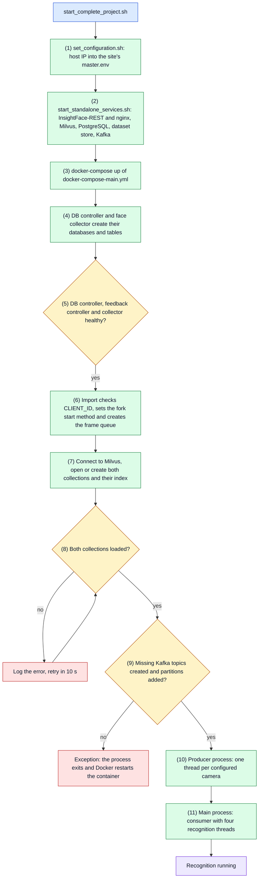
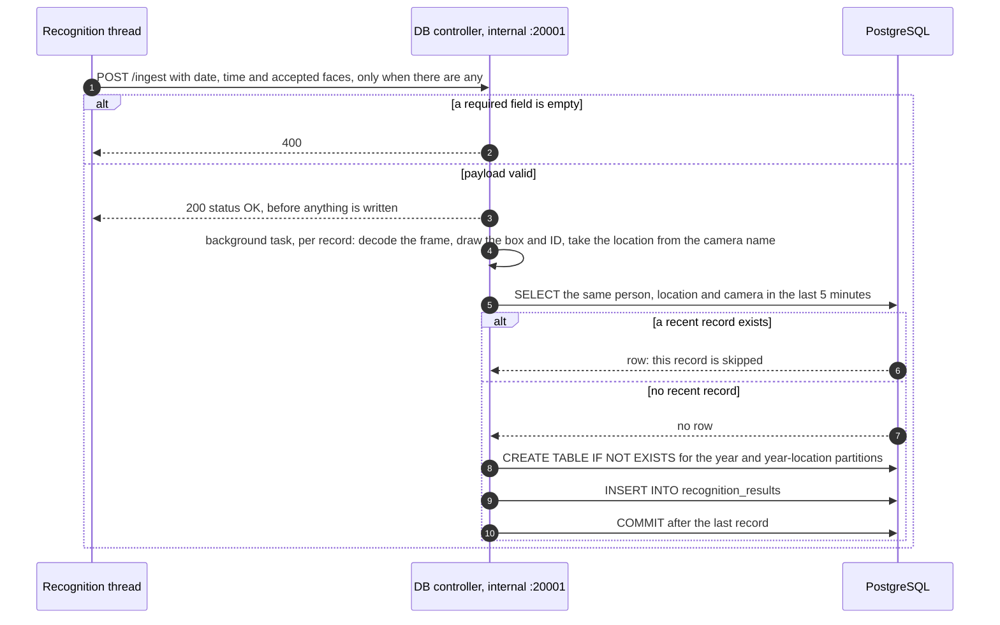
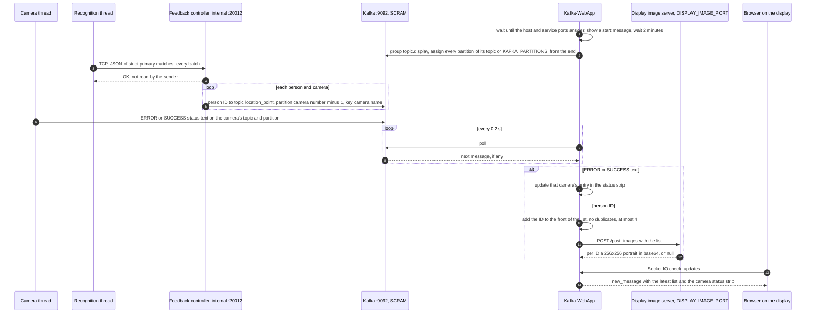
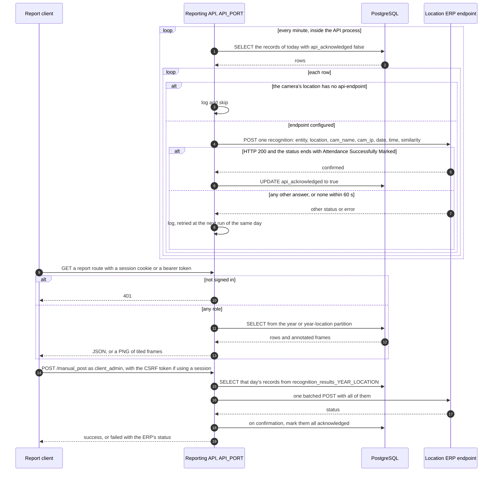
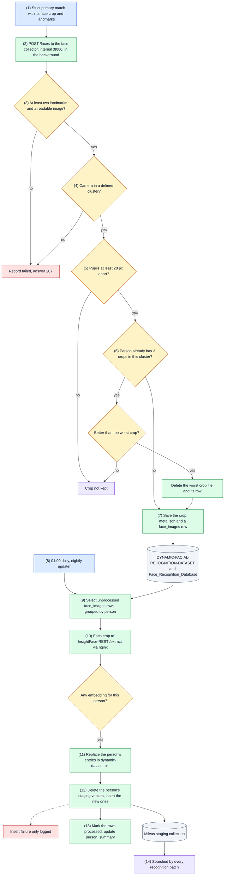
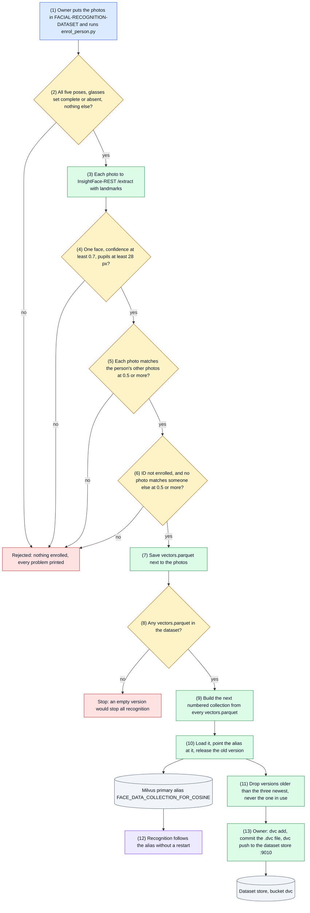
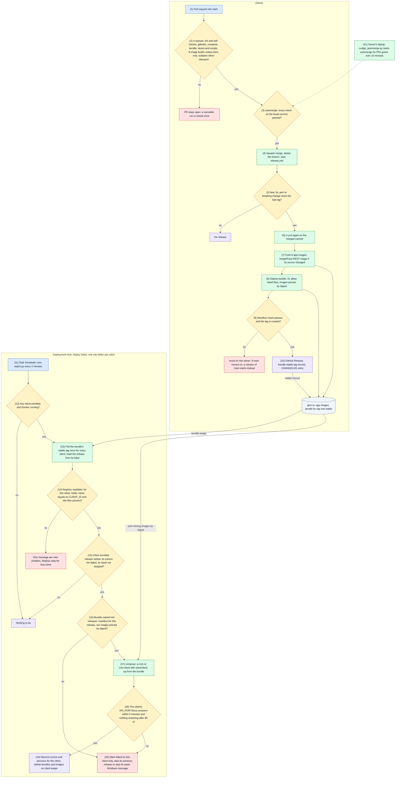

# Flow

How execution travels through the system, one flow per section. The overview is the System Design diagram in the [README](../README.md#system-design); what exists and who owns it is in [ARCHITECTURE.md](ARCHITECTURE.md); stored data is in [DATA.md](DATA.md).

Checked against `main` at e9bf3fc. The latest release tag at that point was `v2.3.0`.

## How to read the diagrams

Flowcharts read top to bottom. Each box has a fixed color:

| Color  | Meaning                               |
|--------|---------------------------------------|
| Blue   | The way in: where the flow starts     |
| Green  | A code step                           |
| Amber  | A decision                            |
| Purple | An outcome a caller or person can see |
| Red    | An error or failure path              |
| Grey   | A data store or an outside service    |

Sequence diagrams use solid arrows for requests and dashed arrows for answers. Branches are `alt` boxes and repeats are `loop` boxes. Mermaid numbers each arrow.

Each section has a diagram, a key that maps names to files, and a numbered trace. The numbers in a trace match the numbers in its diagram: `(n)` in a flowchart box, or the arrow number in a sequence diagram.

## 1. Startup

**Key:** producer-consumer is `src/main.py`, `src/multiprocessing_shared_buffer.py`, `src/milvus_server.py`, `src/multicam_stream_producer.py` and `src/multicam_stream_consumer.py`. Topic creation is `ensure_kafka_topics()` in `src/feedback_server/feedback_message_kafka_publisher.py`. DB controller is `src/database_server/`; face collector is `src/dynamic_face_data_collector/`.

1. `start_standalone_services.sh` first changes to its own folder, so it works the same from a checkout and from a release bundle. `CONFIG_DIR` is the folder with this site's `.env` and `master.env`: the checkout by default, the site folder on a deployment host. It sources `set_configuration.sh`, which reads the host IP through `get_ip.sh`, creates `$CONFIG_DIR/master.env` from `master.env.example` if it is missing, and writes `IP_ADDRESS` into it. No tracked file changes. Every service reaches the others through this IP.
2. The script reads `HOST_PROFILE` from `$CONFIG_DIR/.env`, then starts InsightFace-REST with `deploy_trt_multi-gpu.sh` (one container per `INSIGHTFACE_GPUS` entry, then nginx on 6385), Milvus with authorization on, PostgreSQL (`STANDALONE-SERVICES/PostgreSQL`, container `cctv-postgresql`, shared by every client stack), the dataset store and Kafka (the broker alone, SCRAM logins on 9092, D-037). Milvus and Kafka get `standalone-services.env`, the host profile if any, and `$CONFIG_DIR/master.env` last, so this host's IP wins over the placeholder. The dataset store gets `$CONFIG_DIR/.env`. When `CONFIG_DIR` is not the script's folder, InsightFace-REST keeps its models and TensorRT engines in `$CONFIG_DIR/insightface-models`, so a new release does not rebuild them. Face liveness is commented out. `deploy/test_standalone_scripts.sh` checks both modes with Docker stubbed. The deployment watcher skips steps 1 and 2: it expects these services to run already.
3. `start_complete_project.sh` then runs `docker-compose -f docker-compose-main.yml up -d`. PostgreSQL is no longer part of this stack, so compose does not wait for it: it must already run from step 2. The stack is one compose project per client, `cctv` for the owner and `cctv-<client>` otherwise, with its own network and no fixed container names (D-036).
4. On start, the DB controller creates the partitioned table `recognition_results` in `CCTV_Camera_Surveillance`, and the face collector creates `person_summary` and `face_images` in `Face_Recognition_Database`, if they are missing. They create the databases themselves only on the owner's site with `LEGACY_SHARED_SERVICES=1`; otherwise `deploy/provision.py` made them, owned by the client's role (D-037). Other clients' databases are prefixed (`<client>_cctv_camera_surveillance`).
5. Compose starts the producer-consumer only once the DB controller, feedback controller and face collector report healthy.
6. The first import of `src/parameters.py` reads `CLIENT_ID` from `master.env` and exits unless it is 3 to 30 lowercase letters or digits starting with a letter, so a stack never runs without knowing whose data it touches (D-036). Every app service does the same. It also refuses `LEGACY_SHARED_SERVICES=1` for any client but the owner, and, outside legacy mode, stops at the first login it needs that is missing from its environment (`PG_APP_*`, `MILVUS_APP_*`, `KAFKA_APP_*`), with `run deploy/provision.py <client>`. Importing `multiprocessing_shared_buffer` then sets the `fork` start method, so workers inherit live Milvus collections (D-023), and creates `MULTIPROCESS_SHARED_BUFFER`, an unbounded `multiprocessing.Queue`.
7. `create_connection()` connects to Milvus at the host IP on 19530 with the client's own user, bound to the client's database (`default` for `CLIENT_ID=owner`, `<client>_default` otherwise). Only the legacy owner creates that database at start, and connects without a login. `create_collection()` opens the primary (`FACE_DATA_COLLECTION_FOR_COSINE`, an alias since D-030) and staging (`FACE_DATA_STAGING_COLLECTION_FOR_COSINE`) collections, creating a collection and a `GPU_IVF_FLAT` index (nlist 128) if either is missing.
8. `load_with_retry()` loads each collection, retrying every 10 seconds until it succeeds.
9. `ensure_kafka_topics()` checks for a topic `<client>.<location>_<point>` (`<location>_<point>` for the legacy owner) for each entry point that has cameras, with one partition per camera. Only the legacy owner creates missing topics (5 s retention and 5 s segments) and adds partitions when cameras were added; for any other client a missing topic or partition stops the process with `rerun deploy/provision.py after changing cameras`, since provisioning makes them. Topics are never deleted (D-028). Any failure raises, so the process exits rather than produce to a missing topic, and the restart policy starts it again.
10. The producer process reads `src/Camera-Configuration/camera_configuration.json` and starts one thread per camera, named `<location>_<point>_<camera>`. Section 2 follows each thread.
11. The main process runs `consumer_main()`. With `THREAD_FLAG = True` it starts `NUMBER_OF_THREADS = 4` recognition threads; the multiprocess mode (`NUMBER_OF_PROCESSES = 2`) is off.

## 2. Camera frame to recognition

```mermaid
flowchart TB
    subgraph PRODUCER["`Producer process, one thread per camera`"]
        OPEN["`(1) Open the stream: an HTTP address as is, otherwise RTSP with the camera's credentials`"]:::entry
        OPENED{"`Stream opened?`"}:::decision
        DOWN["`(2) ERROR message to the camera's Kafka partition, wait 30 s, open again`"]:::error
        READ["`(3) Read a frame`"]:::step
        READOK{"`Frame read?`"}:::decision
        ROI["`(4) Crop and mask the ROI polygon, or resize to 640x360`"]:::step
        DARK{"`(5) 80 of the last 100 frames dark?`"}:::decision
        HALT["`ERROR message to Kafka, frame not queued`"]:::error
        Q[("`(6) Frame queue: frame, camera name, camera address`")]:::store
    end
    subgraph CONSUMER["`Main process, four recognition threads`"]
        ENOUGH{"`(7) At least 32 frames queued?`"}:::decision
        BATCH["`Take 32 frames under a lock`"]:::step
        IFR[("`(8) InsightFace-REST /extract via nginx :6385`")]:::store
        SEARCH["`(9) Search primary and staging, top 5 each`"]:::step
        MV[("`Milvus :19530`")]:::store
        PRIM{"`(10) Best primary hit at least 0.5?`"}:::decision
        STAG{"`(11) STAGING on, and a primary hit in the staging top 5 scores at least 0.45?`"}:::decision
        IGN["`Face ignored`"]:::outcome
        STRICT["`Strict primary match: feedback and face crops, sections 4 and 6`"]:::outcome
        LIVE{"`(12) Liveness enabled?`"}:::decision
        LV[("`Liveness service :6386`")]:::store
        ACC["`Accepted faces to the DB controller, section 3`"]:::outcome
        FULL{"`(13) Queue over 4096 frames?`"}:::decision
        PURGE["`Drop the 256 oldest frames`"]:::error
        ERR["`(14) Batch exception: counted, logged every tenth time`"]:::error
    end

    OPEN --> OPENED
    OPENED -->|"`no`"| DOWN --> OPEN
    OPENED -->|"`yes`"| READ --> READOK
    READOK -->|"`no`"| DOWN
    READOK -->|"`yes`"| ROI --> DARK
    DARK -->|"`yes`"| HALT
    DARK -->|"`no`"| Q
    Q --> ENOUGH
    ENOUGH -->|"`yes`"| BATCH --> IFR --> SEARCH --> MV --> PRIM
    PRIM -->|"`yes`"| STRICT
    PRIM -->|"`yes`"| LIVE
    PRIM -->|"`no`"| STAG
    STAG -->|"`no`"| IGN
    STAG -->|"`yes`"| LIVE
    LIVE -->|"`no`"| ACC
    LIVE -.->|"`yes`"| LV
    LV -.->|"`spoofed people removed`"| ACC
    ACC --> FULL
    FULL -->|"`yes`"| PURGE
    BATCH -.->|"`any exception`"| ERR

    classDef entry fill:#dbeafe,stroke:#1d4ed8,color:#0f172a
    classDef step fill:#dcfce7,stroke:#15803d,color:#0f172a
    classDef decision fill:#fef3c7,stroke:#b45309,color:#0f172a
    classDef outcome fill:#ede9fe,stroke:#6d28d9,color:#0f172a
    classDef error fill:#fee2e2,stroke:#b91c1c,color:#0f172a
    classDef store fill:#f1f5f9,stroke:#475569,color:#0f172a
```

**Key:** camera threads are `IPCamera` and `create_camera()` in `src/multicam_stream_producer.py`, which opens each stream with `camera_stream_url()` from `src/util/generic_utilities.py`. Recognition threads are `face_recognition()` in `src/multicam_stream_consumer.py`, which calls `batched_frame_face_recognition()` in `src/insightface_face_recognition.py`. The InsightFace-REST client is `IFRClient` in `src/insightface_face_detection.py`, the search is `search_embedding()` in `src/milvus_server.py`, and the match rules are in `src/inference_data_cleaner.py`. Settings are in `src/parameters.py`.

1. Each camera thread builds an `IPCamera`. `camera_stream_url()`, shared with the ROI page, builds the address: an `ip_address` that starts with `http` is opened as is; anything else becomes `rtsp://<user>:<password>@<ip>:<port>/<endpoint>`, with `CAM_USERNAME`, `CAM_PASSWORD`, `CAM_PORT` and `STREAM_ENDPOINT` as defaults for `null` fields.
2. If the stream does not open, or a read fails later, the thread sends `ERROR <camera>: Camera stream from <camera> is not accessible.` to its Kafka topic and partition, waits `IP_CAM_REINIT_WAIT_DURATION` (30 s) and opens it again. A successful reopen sends a `SUCCESS` message. These messages go straight to Kafka, not through the feedback controller.
3. The thread reads frames continuously. With `FRAME_RATE_FACTOR = 1` every frame is processed.
4. If the camera has `masking-coordinates` (drawn on the ROI page, D-035) and `CROP_ROI` is on, the frame is cropped to the polygon's bounding box, masked outside the polygon, and resized to the area of a 640x360 frame, keeping its aspect ratio. Otherwise a frame larger than 640x360 is resized to it.
5. Darkness detection runs on a blurred copy of the full frame: a frame is dark when its mean grey level is under 80. Over a window of 100 frames, 80 dark frames switch the camera to "too dark": it sends an `ERROR` message and stops queueing. 80 bright frames switch it back and send `SUCCESS`.
6. Frames that pass go into the shared queue as `(frame, camera name, camera address)`. The queue lives in memory and is lost on restart.
7. Each recognition thread checks the queue size and, when at least `BATCH_SIZE = 32` frames are waiting, takes 32 under a lock. Otherwise it checks again at once.
8. The batch goes to InsightFace-REST through nginx on 6385. It returns, per face, a 512-d embedding, a bounding box, a face crop and landmarks.
9. Before each batch the thread loads the staging collection again, so vectors the nightly updater added are searched. Every embedding is searched in both collections, top 5, cosine, `nprobe` 10.
10. A face whose best primary hit scores at least `FACE_MATCHING_TOLERANCE = 0.5` is accepted. This strict match also feeds the display (section 4) and the face collector (section 6).
11. Otherwise, with `STAGING = True`, the IDs in both the primary and the staging top 5 are compared, and the one with the best primary score is accepted if that score is at least 0.45. Staging matches are recorded only. Anything else is ignored.
12. `ENABLE_FACE_LIVENESS_DETECTION = False`, so this check is skipped. When on, each person's strict-match crops go to the liveness service on 6386, and a person with more spoof than real verdicts is removed from the accepted faces. The display and collector still receive that person.
13. After each batch, if the queue holds more than `LIVE_STREAM_BUFFER_SIZE = 4096` frames, the thread drops the 256 oldest, so recognition stays near real time.
14. Any exception in a batch, including an unreachable InsightFace-REST or Milvus, drops that batch. Only every tenth one is logged.

## 3. Recognition to attendance record

**Key:** the client side is `batched_frame_face_recognition()` in `src/insightface_face_recognition.py`. The DB controller is `src/database_server/postgresql_server_controller.py` (FastAPI) and `insert_recognition_data()` in `src/database_server/postgresql_database.py`.

1. The recognition thread posts `{current_date, current_time, results}` to `http://mfr-database-controller:20001/ingest`, by service name on the stack's own network, with a 5 s timeout. `results` maps each person ID to a list of `(camera name, camera address, score, frame as base64 JPEG, bounding box)`. Nothing is sent when no face was accepted, and a failed post is only logged.
2. A payload with an empty field is refused with 400.
3. Otherwise the controller schedules the insert as a background task and answers `{"status": "OK"}` at once. The caller never learns whether the insert worked.
4. For each record the task decodes the frame, draws the box, ID and score on it, reduces an `http` camera address to its host name, and takes the location as the part of the camera name before the first underscore.
5. It takes a lock on the person until the commit, so parallel batches cannot both pass the next check, then looks for a record of the same person, location and camera in the last `SAME_CAM_TIME_ENTRY_THRESHOLD = 5` minutes.
6. A recent record means a duplicate: this record is skipped.
7. No recent record: the insert goes ahead.
8. The task creates the partition `recognition_results_<year>` (by date range) and its child `recognition_results_<year>_<location>` (by list) if they are missing.
9. It inserts person, location, camera, camera address, date, time, score and the annotated frame, with `api_acknowledged` false. PostgreSQL routes the row to its partition.
10. The task commits once, after the last record.

## 4. Recognition to display

**Key:** the sender is `batched_frame_face_recognition()` in `src/insightface_face_recognition.py` with `feedback_data_formatter()` in `src/inference_data_cleaner.py`. The feedback controller is `src/feedback_server/feedback_msg_server_controller.py` and `feedback_message_publisher()` in `feedback_message_kafka_publisher.py`. The topic and partition map is `map_camera_to_kafka_topic_and_partition()` in `src/util/generic_utilities.py`. The display image server is `src/fetch_face_image_server/`. Kafka-WebApp runs from the image `ghcr.io/hamza-aziz-ai/kafka-webapp:v0.4.1`, pinned by digest in `docker-compose-main.yml`; its code (`app.py`, `parameters.py`) lives in its own repository and was checked here at the `v0.3.0` tag (`c1f4d7f`).

1. Kafka-WebApp checks that the host answers on `HOST_CHECK_PORT` and that every service it depends on answers: the `host:port` entries of `PROJECT_SERVICES`, or, when that is unset, the ports in `PROJECT_SERVICES_PORT` on `IP_ADDRESS` (which defaults to 127.0.0.1). The compose file sets `HOST_CHECK_PORT` to 9092 and `PROJECT_SERVICES` to 6385, 19000, 19530, 9092 and the client's internal services by name (`mfr-database-controller:20001`, `mfr-feedback-controller:20012`, `display-image-server:20013`). Then it shows a start message and waits 2 minutes.
2. It reads `KAFKA_TOPIC` (default `maingate_entry`) as consumer group `<topic>.display`, and assigns itself every partition of the topic, so every camera of the entry point is shown; `KAFKA_PARTITIONS` (camera number minus 1, comma-separated) narrows it to chosen cameras. It starts at the end, so old messages are never replayed, and checks for partitions added with a new camera every 60 s. Since D-037 the broker accepts only SCRAM logins on 9092; the compose file passes the client's read-only display login as `KAFKA_USERNAME` and `KAFKA_PASSWORD`, and an empty one, on the legacy owner, means no login.
3. When `ENABLE_FEEDBACK_SERVER` is on, the recognition thread opens a TCP connection to `mfr-feedback-controller:20012`, by service name, after every batch and sends the strict primary matches as JSON: person ID to `(camera name, camera address, score, recognized)`. The JSON is sent even when empty.
4. The controller reads up to 1 MB, answers `OK` and closes the connection. The sender does not read the answer.
5. In a new thread, the controller publishes each person ID, over SCRAM with the client's `KAFKA_APP_*` login (none for the legacy owner), to the topic `<client>.<location>_<point>` (`<location>_<point>` for the legacy owner), on partition `<camera number> - 1` taken from the camera key (`cctv-camera-3` is partition 2), with the camera name as key, and flushes after each message.
6. Camera threads publish their own `ERROR <camera>: ...` and `SUCCESS <camera>: ...` messages to the same topic and partition (section 2, steps 2 and 5). Topics keep messages for 5 s.
7. Kafka-WebApp polls every 0.2 s.
8. Each message is a person ID or a camera status text.
9. An `ERROR <camera>: ...` or `SUCCESS <camera>: ...` text updates that camera's entry in a status strip and never enters the recognition list or `/post_images`. An `ERROR` stays until the same camera's `SUCCESS`; a `SUCCESS` shows for 5 s.
10. A person ID goes to the front of the list unless it is already there; the list holds at most `DISPLAY_LIST_SIZE = 4`.
11. After each person ID Kafka-WebApp posts the list to `IMAGE_SERVER_ADDRESS`, which the compose file sets to this client's own server, `http://display-image-server:20013/post_images`, with a 5 s timeout.
12. The display image server returns, for each ID, `DISPLAY-FACE-DATASET/<id>/front_face.jpg` resized to 256x256 as base64, or null if there is none, for which the display (v0.6.0 or later) draws a silhouette coloured from the ID. It still turns an `ERROR` or `SUCCESS` text into `{"ERROR": text}` or `{"SUCCESS": text}`, but v0.3.0 no longer sends those. It has no authentication and allows any origin.
13. The browser asks for updates over Socket.IO.
14. Kafka-WebApp sends the latest list and the current camera status strip, which the page shows. The list clears after 15 s without a new recognition.

## 5. ERP sync and reporting API

**Key:** everything here is `src/api/app.py`: `start_scheduler()`, `process_unacknowledged_rows()` and `post_to_api()` for the sync, one function per route for the reports. The ERP address per location is `api-endpoint` in the camera configuration, mapped per camera by `map_camera_to_api_endpoint()` in `src/util/generic_utilities.py`.

1. An APScheduler job inside the API process runs every minute and selects the records of the current date that are not acknowledged.
2. PostgreSQL returns them. Records of earlier days are never retried automatically; `/manual_post` sends them.
3. A camera whose location has no `api-endpoint` is skipped.
4. Each record is posted on its own as `{"recognition": [{entity, location, cam_name, cam_ip, date, time, similarity}]}`, with the date as `DD-MM-YYYY` and a 60 s timeout.
5. The ERP confirms with HTTP 200 and a `data.status` that starts with `Status:` and ends with `Attendance Successfully Marked`.
6. Only then is the row marked `api_acknowledged = true`.
7. Any other status, an empty `data`, an HTTP error or a timeout.
8. The error is logged and the row is tried again a minute later, until midnight.
9. Report routes need a session from `POST /auth/login` or a machine token as `Authorization: Bearer` (D-039). Dates use `DD-MM-YYYY`.
10. A wrong key gets 403. The key is compared with `==` (THREAT.md).
11. Person, camera and tiled-frame routes select from the year partition `recognition_results_<year>`; location and time-window routes from `recognition_results_<year>_<location>`.
12. Rows come back with their annotated frames where the route needs them.
13. The answer is JSON, or a PNG for the frame routes.
14. `/manual_post` takes a date and location, needs the same key, and finds the ERP address from the location in the camera configuration (404 for an unknown location, 400 if it has no endpoint).
15. It selects every record of that day from the location's partition, acknowledged or not.
16. It sends them in one request.
17. The ERP answers with a status.
18. On the same confirmation as step 5, every sent row is marked acknowledged.
19. The client gets the outcome and the ERP's status.

Report routes:

| Method | Route                                                     | Returns                                            |
|--------|-----------------------------------------------------------|----------------------------------------------------|
| GET    | `/fetch_person_data?date&person_id[&camera_name]`         | Recognitions for a person on a date                |
| GET    | `/fetch_camera_data?date&camera_name`                     | Recognitions from one camera                       |
| GET    | `/fetch_module_data?date&module`                          | Recognitions for one location                      |
| GET    | `/fetch_tiled_frames?date&person_id`                      | PNG of the person's annotated frames               |
| GET    | `/fetch_frames_by_time?date&module[&start_time&end_time]` | PNG of frames in a time window (`HH:MM AM/PM`)     |
| POST   | `/manual_post?date&location`                              | Re-sends a day's records for a location to the ERP |

## 6. Dynamic face collection and the nightly Milvus updater

**Key:** the sender is `collect_cropped_face_data()` in `src/inference_data_cleaner.py` and `submit_faces_async()` in `src/util/face_data_client.py`. The collector is `src/dynamic_face_data_collector/` (`api.py`, `face_saver.py`, `postgresql_database_handler.py`). The updater is `src/automatic-vector-db-updation/milvus_updater.py`.

1. When `SAVE_FACE = True`, the recognition thread collects the crops of strict primary matches, with score, camera and landmarks.
2. `submit_faces_async()` posts them as JSON to `http://dynamic-face-dataset-collector:8000/faces`, by service name, from a pool of 16 threads, so recognition does not wait.
3. A record needs at least two landmarks and a decodable base64 image. A failed record is reported in a 207 answer; the others still count.
4. `get_cluster()` maps the camera to a cluster. Only the `maingate` entry and exit cameras 1 to 10 have clusters (`cluster-1` to `cluster-4`); any other camera raises an error and the record fails.
5. The pupil distance, from the first two landmarks, must be at least `PUPIL_DISTANCE_THRESHOLD = 28` px. A smaller face is not kept.
6. Each person keeps at most `NUMBER_OF_PICTURES = 3` crops per cluster. When the cluster is full, the worst crop (smaller pupil distance, then lower score) is replaced if the new one is better; otherwise the new crop is not kept. `src/dynamic_face_data_collector/test_face_saver.py` checks both cases in CI.
7. The crop is saved under `DYNAMIC-FACIAL-RECOGNITION-DATASET/<person>/<cluster>/`, `meta.json` is updated, and a `face_images` row is inserted with `is_processed` false.
8. The updater container runs `process_unprocessed_images_from_db()` every day at 01:00, container time. The module docstring still says 12:00 AM.
9. It selects every `face_images` row not yet processed and groups them by person.
10. Each crop is read from disk and sent to InsightFace-REST on 6385 for its embedding.
11. A person with at least one embedding has all their entries in `DYNAMIC-FACIAL-RECOGNITION-DATASET/FACE_EMBEDDINGS/dynamic-dataset.pkl` replaced by the new ones.
12. In the staging collection, all the person's vectors are deleted and the new ones inserted. So a person's staging vectors are only that night's crops. A failed delete or insert is logged and the run goes on.
13. The rows are marked processed and `person_summary` is updated, even when the insert failed, so those vectors are lost silently.
14. Recognition threads load the staging collection before every batch (section 2, step 9), so the new vectors are used from the next batch.

## 7. Enrollment and face-vector publishing

**Key:** `src/util/enrol_person.py` runs the checks in `src/util/enrolment_checks.py` (D-026) and publishes with `src/util/face_vectors.py` (D-030). Thresholds come from `src/parameters.py`.

1. The folder name is the person's ID. The owner gets the person's written consent first: these are biometric data.
2. `check_files()` needs `front`, `chin_up`, `chin_down`, `left_30` and `right_30` as `.jpg`. The five `_glasses` versions are all or nothing. Any other file name is a problem.
3. Each photo goes to InsightFace-REST, which returns its faces with embeddings and landmarks. The sharpness is printed but not checked.
4. `check_face()` needs exactly one face, detection confidence of at least `ENROLMENT_MIN_CONFIDENCE = 0.7` and pupils at least 28 px apart.
5. `check_same_person()` needs each photo's median cosine similarity to the person's other photos to be at least 0.5, which catches someone else's photo in the folder.
6. The script refuses an ID already in the primary collection and any photo whose best match is someone else at 0.5 or more, which catches duplicates and mixed-up IDs. Any problem in steps 2 to 6 rejects the whole person.
7. `face_vectors.save()` writes `FACIAL-RECOGNITION-DATASET/<person_id>/vectors.parquet` with `name_id` and `embeddings`, so photos and vectors share one DVC version.
8. `publish()` stops if the primary name is still a plain collection rather than an alias (run `migrate` first), and if no `vectors.parquet` exists.
9. It builds `FACE_DATA_COLLECTION_FOR_COSINE_v<n>`, one higher than the newest version, from every person's `vectors.parquet`, in batches of 5000.
10. It connects with the client's own Milvus login, inside its own database (D-037 lets the publisher create collections and move the alias there). It loads the new version, creates or moves the alias `FACE_DATA_COLLECTION_FOR_COSINE` to it, and releases the previous version so only one uses GPU memory.
11. It keeps the three newest versions and drops older ones, except the one in use.
12. The recognition threads keep using the alias name. D-030 records that a running `Collection` follows an alias switch without a restart (tested then, not re-checked here).
13. The owner versions the dataset: `dvc add FACIAL-RECOGNITION-DATASET`, commit the `.dvc` file, `dvc push`. A portrait for the display goes to `DISPLAY-FACE-DATASET/<id>/front_face.jpg`, versioned the same way.

Related commands:

- `python3 src/util/face_vectors.py use <n>` points the alias at version `n`, for a rollback. `list` shows the versions and the one in use.
- `python3 src/util/face_vectors.py migrate` runs once on an existing install: it builds a version from the photos, renames the live collection to `_v0` and creates the alias.
- `src/util/insightface_embeddings.py <folder> <embeddings.pkl>` builds an embeddings pickle for a group, and `src/util/upload_embeddings.py <embeddings.pkl>` saves it into the dataset's `vectors.parquet` files and publishes. These skip the photo checks, and replace only the vectors of the people in the pickle.

## 8. Release and deploy

**Key:** workflows are in `.github/workflows/`: `ci.yml`, `automerge.yml`, `release.yml` and `insightface-image.yml`. The bundle is `deploy/make_bundle.py` and `deploy/bundle.Dockerfile`; the manifest check is `mlops/check_manifest.py`. The watcher is `deploy/watch.py`, tested by `deploy/test_watch.py`; the automerge nudge is `deploy/nudge_automerge.py`. On the host, the deploy folder (for example `C:\deploy\cctv`) holds `watch.py`, `watch.log`, `releases\` and `sites\<client>\`, one folder per client with its config, data and `state.json` (D-036). Steps 14 to 20 run for each client in turn.

1. Every pull request into main starts `ci.yml`, plus `insightface-image.yml` when InsightFace-REST source or `standalone-services.env` changed.
2. `ci` is the aggregate check of two jobs, as GitHub bills each job by the whole minute. The `checks` job runs every check that needs no image: ruff for syntax errors and undefined names, `check_manifest.py`, `test_watch.py`, `nudge_automerge.py demo`, `enrolment_checks.py`, the gitleaks secret scan, and compose validation, which includes the PostgreSQL compose file, a sample bundle from `make_bundle.py demo`, `deploy/test_standalone_scripts.sh` and `deploy/test_layout.py` (two client stacks side by side). It also decides whether images are built: a pull request that changes only `docs/` or Markdown files skips them, and arm64 is built on a pull request only when a Dockerfile, a `requirements.txt`, `ci.yml` or `release.yml` changes; pushes and release runs always build both. The `images` job builds each of the eight images on each architecture with smoke tests, including the start method and `face_vectors.py demo` in the producer-consumer image, the face-saver test in the collector image and the ROI page test in the ROI image. In a release run it pushes the images that passed, so the release never builds them again. The isolation step runs `deploy/test_isolation.py`, about 5 minutes on throwaway PostgreSQL, Kafka, Milvus and MinIO, only for pull requests that touch provisioning, `STANDALONE-SERVICES/`, `src/parameters.py`, `src/milvus_server.py` or `src/util/face_vectors.py`.
3. `automerge.yml` runs from main's copy when `ci` or `Claude Code Review` completes, or by hand. If a first attempt had canceled jobs and its commit is still a pull request's head, the failed jobs are re-run once; a real failure is not retried. It merges an open, non-draft pull request from this repository only when `ci` passed and every other check on the head commit passed, skipped or was neutral; each skip is logged with the checks it saw (D-013, D-029).
4. It squash-merges with `--match-head-commit`, deletes the branch, sweeps again for stacked pull requests, and starts `release.yml` if anything merged.
5. `plan` reads the commit subjects since the last `v*.*.*` tag: `type!:` or a `BREAKING CHANGE` footer gives a major bump, `feat:` minor, `fix:` or `perf:` patch. Anything else, such as `docs:`, ends the run with no release (D-014).
6. `ci.yml` runs again on the exact merged commit.
7. `images` builds with both compose files and the `roi` profile, and pushes the eight app images, the ROI page included, to `ghcr.io/hamza-aziz-ai/cctv-face-recognition-<service>:<tag>`, one at a time (D-017). `insightface-image.yml` builds `cctv-face-recognition-insightface-rest:<version>-<git tree of src>` only if that tag does not exist yet.
8. `bundle` collects each image's digest and runs `make_bundle.py`, which copies 21 allow-listed files (compose files, the shared Kafka and Milvus auth settings, ops scripts, templates, the InsightFace-REST license, and the host tools `deploy/watch.py` and `deploy/provision.py`), pins every image by digest and writes `release-manifest.json`. It pushes `cctv-face-recognition-deploy:<tag>`, retrying up to three times (D-033).
9. `publish` runs `check_manifest.py`, then creates the tag. If tagging fails and main has moved on, it starts a release of main instead and stops. Any failed job opens an issue assigned to the owner.
10. It creates the GitHub Release with `mlops/model-manifest.json` attached, moves the bundle's `stable` tag unless it already points at a newer release, and adds the notes to `CHANGELOG.md`. Release-failure issues opened earlier are closed. Only this workflow moves `stable`, so hosts trust it for what to deploy.
11. On the host, Task Scheduler runs `pythonw watch.py` in the deploy folder every 2 minutes (owner, 2026-11-03; was 10) while the owner is signed in. A lock file stops overlapping runs. The host holds no repository and no GitHub login, only a pull-only registry login (D-034).
12. The watcher does nothing until at least one client has a `sites\<client>\state.json` (the owner ran `--enroll <client>`) and Docker answers. `--enroll <client>` deploys that client alone.
13. One pull serves every client: it pulls `ghcr.io/hamza-aziz-ai/cctv-face-recognition-deploy:stable` and reads the release tag from the image's `org.opencontainers.image.version` label, and the bundle's digest.
14. If the pull fails, most often because the registry token expired, every client gets the problem. For each client, the folder name must be a valid ID and equal `CLIENT_ID` in its `master.env`, since the folder decides the state, data and project name; and `.env`, `master.env` and `src\Camera-Configuration\camera_configuration.json` must exist in it. Otherwise deploys stop for that client, and the owner gets one Windows message per new problem, not one every 10 minutes.
15. A client without `state.json` is skipped unless it is being enrolled. It deploys only a release that is neither that client's current one nor in its failed list, and never while the owner has stopped that client's stack. `--enroll` skips these checks; `--check` stops after step 16 and deploys nothing.
16. It copies the bundle out of the image with `docker create` and `docker cp`, never running it, into a temporary folder. It refuses the bundle unless `release-manifest.json` is schema 1 for this release and pins every image to `ghcr.io/hamza-aziz-ai/cctv-face-recognition-*` by digest, and the compose file has no build, no checkout mount and no `IMAGE_TAG`. Then it renames the folder to `releases\<tag>`. A refused bundle counts as a failed deploy.
17. It runs `docker compose -p <project> --project-directory sites\<client> -f releases\<tag>\docker-compose-main.yml up -d --pull missing --no-build --wait --wait-timeout 600`, where the project is `cctv` for the owner and `cctv-<client>` otherwise, so every release runs as the same stack for that client, with its config and data.
18. It waits up to 5 minutes for HTTP 200 from `http://localhost:<API_PORT>/docs`, with `API_PORT` read alone from the client's `.env` (9090 if unset), then 90 seconds, and fails if any container of the client's project is restarting or exited.
19. On success the tag becomes the client's current release and the old one its previous. Bundles and our images that no client's current or previous release uses are deleted, so one client's deploy never removes another's rollback; the InsightFace-REST image and local dev builds stay.
20. On any failure the tag is added to that client's failed list and never retried unattended. That client alone goes back to its previous release, from the bundle and images still on the host, or its stack is stopped if there is none, and a Windows message is shown. Other clients are not touched. Details are in [ROLLBACK.md](ROLLBACK.md).
21. Starting automerge for a green pull request left open needs the owner's `gh` login, so `deploy/nudge_automerge.py` runs every 10 minutes on the owner's laptop from the dev checkout, never on a deployment host. It starts `automerge.yml` for any open pull request whose checks all passed more than 15 minutes ago (D-029).
